# 舰桥 UI 实现计划

> **状态**：设计阶段。本文档不含真实代码文件，未改动任何环境。
> **和另一份文档的关系**：`IMPLEMENTATION-PLAN.md` 是"给 dsh 做配置页插件"；**这一份是完全独立的另一个项目**，两者互不依赖。
> **怎么看图**：用 Mermaid 绘制。GitHub / GitLab 直接渲染；VS Code 需装 *Markdown Preview Mermaid Support*；也可粘到 <https://mermaid.live> 导出 PNG/SVG。
> **阅读顺序**：完全不懂技术 → 先读第 1、2 章；想看结构 → 第 6 章；准备动手 → 第 18 章。

---

# 第一部分 · 先搞懂这是什么

## 1. 一句话说清

做一个**独立的网页应用**：它长得像一艘未来飞船的驾驶舱，把你的目标、行动、学习、项目、人际…都变成"舰桥仪表"，而且**整个画面的氛围会跟着你的当前状态变**。

## 2. 给小白的三分钟入门

### 2.1 它和上一个项目完全无关

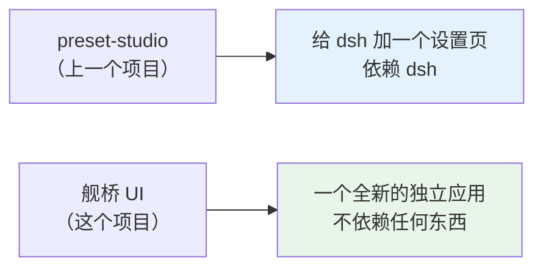

**舰桥不依赖 dsh，也不需要 dsh。** 它是一个自己站得住的应用。

### 2.2 三个关键概念

| 概念 | 大白话 | 在界面上的样子 |
|---|---|---|
| **悬窗** | 占满屏幕的那面"宇宙窗" | 背景里的星海、行星、空间站 |
| **环境状态** | 系统当前的心情 | 平稳 / 忙碌 / 完成 / 深夜 / 异常 |
| **状态推导** | 把你的数据翻译成"心情"的那段计算 | 你看不见，但它是心脏 |

### 2.3 核心机制，一句话

> **你的数据 → 环境状态 → 画面氛围**

举五个例子，一眼看懂：

| 你的情况 | 环境状态 | 画面变成 |
|---|---|---|
| 今天任务都做完了 | **完成** | 悬窗出现一颗新抵达的行星 |
| 正在冲刺，一半任务没做完 | **忙碌** | 进入高速航行，星星拉成轨迹 |
| 正常推进，不紧不慢 | **平稳** | 安静的星海，天体缓慢运行 |
| 凌晨还在用 | **深夜** | 整体压暗，只剩微光 |
| 逾期任务堆得太多 | **异常** | 环境出现轻微警示，航行状态变化 |

**这条链子就是整个应用的心脏。** 记住它，后面所有设计都是在服务它。

### 2.4 这个项目要写多少代码

给个心理预期，免得被吓到：

| 部分 | 大致行数 | 难度 |
|---|---|---|
| 数据与逻辑（`core/` + `data/`） | ~400 行 | ⭐ 简单，纯函数 |
| 舰桥外壳（`shell/`） | ~500 行 | ⭐⭐ 中等，主要是布局和 CSS |
| 九个模块页（`pages/`） | ~1500 行 | ⭐⭐ 中等，重复劳动多 |
| 公共零件（`components/`） | ~300 行 | ⭐ 简单 |
| 样式（`theme/`） | ~300 行 | ⭐⭐ 中等，调效果花时间 |

**总共约 3000 行**，其中真正的"逻辑"只有 400 行，其余都是界面。

## 3. 目标与非目标

### 目标

1. 一个**独立网页应用**，全屏沉浸，打开就是舰桥
2. **九个模块**：驾驶舱 / 今日 / 项目 / 学习 / AI / 人际 / 规划 / 技能 / 系统
3. **状态驱动氛围**：画面随你的数据实时变化
4. **分层解耦**：换视觉不碰数据，换数据不碰视觉

### 非目标（明确划出去，防止越做越大）

- ❌ 不做 dsh 插件（已确认：独立应用）
- ❌ 不做多人协作 / 社交
- ❌ 不做手机端优先（先做桌面全屏）
- ❌ 不做云同步（先本地存储）
- ❌ 不做逐条编辑的复杂表单（先跑通主流程）

---

# 第二部分 · 为什么这么做

## 4. 技术选型依据：为什么是独立应用

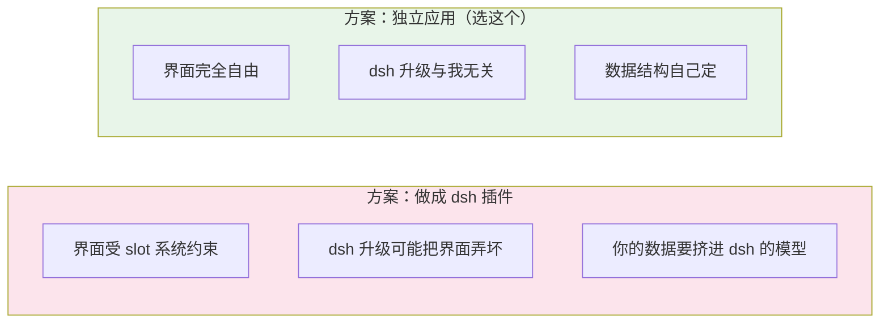

### 决定性理由

你已确认：**环境状态来自你自己的数据**（目标进度、日程、学习记录）。

这意味着舰桥和 dsh 的**信息架构零重叠**：

| | dsh 的界面 | 舰桥的界面 |
|---|---|---|
| 组织方式 | 围绕**对话** | 围绕**人生管理** |
| 有什么 | 会话列表 + 聊天 + 工具调用 | 目标 + 行动 + 状态 + 九模块 |

**硬塞进 dsh 的 slot 系统，是逆着它的设计用力。** 独立应用是唯一合理的选择。

### 附带的好处

| 好处 | 说明 |
|---|---|
| 界面完全自由 | 磨砂、暗色、动态背景，想怎么做怎么做 |
| 不怕上游升级 | dsh 还是测试版会破坏兼容；独立应用不受影响 |
| 标准 React 技能 | 不用学 dsh 的 slot、Typert、Cordis 那套 |
| 可选的 AI 增强 | 将来想加 AI 副官，接 dsh 或别的大模型都行，**不是必须** |

### 用什么架构：三层

一句话：**把"存数据"、"做判断"、"画界面"拆成三层，各管一摊。**

后面第 5 章会详细展开——这是全文最重要的概念。

---

# 第三部分 · 这个项目长什么样

## 5. 总体架构：三层 ★

**这是最重要的概念。** 整个应用分成三层，数据像水一样从上往下流：

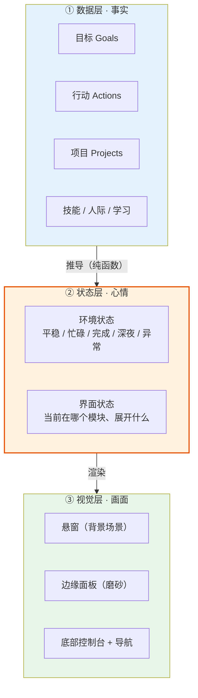

### 为什么非要分三层

| 层 | 只干这个 | 绝不干这个 | 大白话 |
|---|---|---|---|
| **数据层** | 存**事实**（有哪些目标、今天做了什么） | 不算"心情"，不管怎么显示 | **航海日志** |
| **状态层** | 算**心情**（现在该显示什么氛围） | 不存数据，不画界面 | **舰长的判断** |
| **视觉层** | 画（把状态变成像素） | 不碰数据，不做判断 | **仪表盘** |

**好处（这是分层解耦的全部意义）**：

- 想换背景风格？**只改视觉层**，数据和逻辑一行不动
- 想加一个新数据源？**只改数据层**，视觉层自动适应
- 想验证"什么时候该显示忙碌"？给状态层写一个单元测试就行，**不用打开浏览器**

> 🧠 **一句话记住**：状态层是纯函数——**给同样的数据，永远算出同样的心情**。这让它可以被测试、被信任。

## 6. 项目结构分层总图 ★

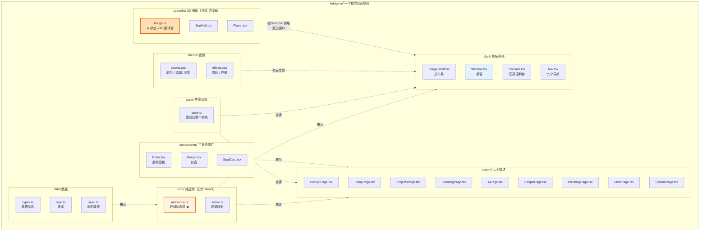

### 对应的实际目录

```text
bridge-ui/
│
├── index.html                ← 网页的入口文件
├── package.json              ← 依赖清单
├── vite.config.ts            ← 开发服务器 / 打包配置
├── tsconfig.json             ← TypeScript 配置
│
├── src/
│   │
│   ├── main.tsx              ← 【入口】把应用挂到网页上
│   ├── App.tsx               ← 【根组件】组装外壳 + 当前页
│   │
│   ├── core/                 ← 【纯逻辑】没有 React，可以单独测试
│   │   ├── ambience.ts       ←   环境状态机 ★ 整个应用的心脏
│   │   ├── scene.ts          ←   状态 → 场景参数（亮度/速度/配色）
│   │   └── derive.ts         ←   各种推导（进度、逾期数、忙碌度）
│   │
│   ├── data/                 ← 【数据】只存事实
│   │   ├── types.ts          ←   数据结构定义
│   │   ├── repo.ts           ←   读写（对外的唯一出口）
│   │   └── seed.ts           ←   首次运行的示例数据
│   │
│   ├── state/                ← 【界面状态】当前在看哪个模块等
│   │   └── store.ts          ←   全局状态
│   │
│   ├── shell/                ← 【外壳】舰桥的"船体"
│   │   ├── BridgeShell.tsx   ←   总布局：悬窗 + 边缘面板 + 控制台
│   │   ├── Window.tsx        ←   悬窗（背景场景渲染）
│   │   ├── Console.tsx       ←   底部一体化控制台
│   │   └── Nav.tsx           ←   九个导航模块
│   │
│   ├── pages/                ← 【九个模块】各一页
│   │   ├── CockpitPage.tsx   ←   驾驶舱（总览，最后做）
│   │   ├── TodayPage.tsx     ←   今日
│   │   ├── ProjectsPage.tsx  ←   项目
│   │   ├── LearningPage.tsx  ←   学习
│   │   ├── AiPage.tsx        ←   AI（可选）
│   │   ├── PeoplePage.tsx    ←   人际
│   │   ├── PlanningPage.tsx  ←   规划
│   │   ├── SkillsPage.tsx    ←   技能
│   │   └── SystemPage.tsx    ←   系统（设置）
│   │
│   ├── components/           ← 【零件】可复用的界面小块
│   │   ├── Panel.tsx         ←   磨砂面板
│   │   ├── Gauge.tsx         ←   仪表
│   │   └── GoalCard.tsx      ←   目标卡片
│   │
│   ├── scene3d/              ← 【可选】只在选方案 B（3D 悬窗）时需要
│   │   ├── BridgeCanvas.tsx  ←   R3F 的 <Canvas> 外壳
│   │   ├── bridge.ts         ←   ★ 状态 → 3D 参数的翻译层
│   │   ├── Starfield.tsx     ←   星海
│   │   ├── Planet.tsx        ←   行星（完成时出现）
│   │   ├── Station.tsx       ←   空间站（异常时）
│   │   └── effects/
│   │       ├── WarpEffect.tsx←   忙碌时的星轨
│   │       └── Fog.tsx       ←   雾 / 朦胧
│   │
│   └── theme/                ← 【视觉】颜色、模糊、动画
│       ├── tokens.css        ←   设计变量（改这里换整套皮肤）
│       ├── effects.css       ←   磨砂、光晕
│       └── window.css        ←   悬窗样式（方案 A 用；方案 B 可删）
│
└── dist/                     ← 打包产物（自动生成，不手改）
```

> 🔑 **一句话记住**：`core/` 是大脑，`data/` 是日志，`shell/` 是船体，`pages/` 是各舱室，`components/` 是家具，`theme/` 是涂装。
>
> 🎨 **`scene3d/` 是唯一的可选目录**——选方案 A（CSS 悬窗）时**整个目录都不存在**。这也是为什么两套方案的切换成本低：`Window.tsx` 的对外接口不变（都接收 `spec`），只是内部实现换掉。

### 代码结构：每个文件长什么样

看一个具体例子就懂了。**每个文件都是一个"出口"**——只暴露该暴露的，其余藏起来。

```ts
// ── data/types.ts：只导出"类型"，没有代码 ──────────────
export interface Goal { id: string; title: string; /* ... */ }

// ── data/repo.ts：只导出一个 repo 对象，所有读写的唯一出口 ──
export const repo = {
  listGoals: () => { /* ... */ },
  saveGoal:  (g: Goal) => { /* ... */ },
}

// ── core/ambience.ts：只导出两个东西（一个类型 + 一个函数）──
export type Ambience = 'calm' | 'cruising' | 'arrival' | 'night' | 'warning'
export function deriveAmbience(input: AmbienceInput): Ambience { /* ... */ }

// ── shell/Window.tsx：只导出一个组件 ──────────────────────
export function Window({ spec }: { spec: SceneSpec }) { /* ... */ }
```

**规律**：

| 文件类型 | 导出什么 | 命名 |
|---|---|---|
| 类型文件 | 一堆 `interface` / `type` | `types.ts` |
| 数据文件 | 一个 `repo` 对象 | `repo.ts` |
| 逻辑文件 | 若干纯函数 | `ambience.ts` |
| 组件文件 | 一个大写开头的函数 | `Window.tsx` |
| 样式文件 | 无导出（全局生效） | `tokens.css` |

---

# 第四部分 · 核心机制

## 7. 环境状态机 ★

这是整个应用**唯一的核心抽象**。先把"状态"定义清楚：

```ts
// src/data/types.ts 里的一部分
export type Ambience =
  | 'calm'       // 平稳：安静星海
  | 'cruising'   // 忙碌：高速航行
  | 'arrival'    // 完成：抵达新行星
  | 'night'      // 深夜：静谧深空
  | 'warning'    // 异常：环境警示
```

### 状态怎么算出来

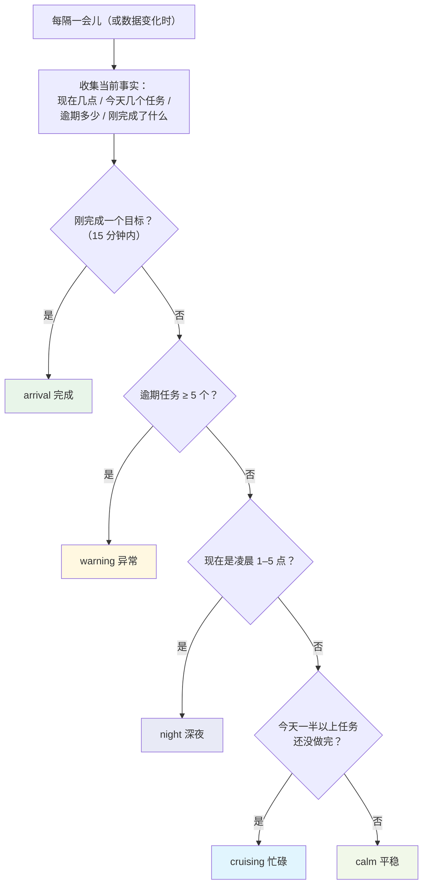

⚠️ **判断顺序很重要**。比如凌晨刚完成一个目标——应该显示"完成"（喜悦优先），而不是"深夜"。所以顺序是：**完成 → 异常 → 深夜 → 忙碌 → 平稳**。

### 代码长什么样

```ts
// src/core/ambience.ts
// 纯函数：给同样的输入，永远算出同样的结果。没有副作用，好测试。

import type { Action } from '../data/types'

export type Ambience = 'calm' | 'cruising' | 'arrival' | 'night' | 'warning'

export interface AmbienceInput {
  now: Date                      // 现在几点
  actionsToday: Action[]         // 今天的行动
  overdueCount: number           // 逾期数量
  lastCompletedAt?: Date         // 最近一次完成目标的时间
}

/** 刚刚完成，值得庆祝的窗口（分钟） */
const CELEBRATE_WINDOW_MIN = 15
/** 逾期到这个数就该警示了 */
const WARNING_OVERDUE_THRESHOLD = 5

export function deriveAmbience(input: AmbienceInput): Ambience {
  const { now, actionsToday, overdueCount, lastCompletedAt } = input

  // ① 完成 —— 喜悦优先于一切
  if (lastCompletedAt && minutesBetween(lastCompletedAt, now) < CELEBRATE_WINDOW_MIN) {
    return 'arrival'
  }

  // ② 异常 —— 堆积太多
  if (overdueCount >= WARNING_OVERDUE_THRESHOLD) {
    return 'warning'
  }

  // ③ 深夜 —— 凌晨 1 点到 5 点
  const hour = now.getHours()
  if (hour >= 1 && hour < 5) {
    return 'night'
  }

  // ④ 忙碌 —— 今天的事还剩一半以上
  const remaining = actionsToday.filter(a => !a.done).length
  if (actionsToday.length > 0 && remaining * 2 >= actionsToday.length) {
    return 'cruising'
  }

  // ⑤ 其余：平稳
  return 'calm'
}

function minutesBetween(a: Date, b: Date): number {
  return (b.getTime() - a.getTime()) / 60000
}
```

**这段代码的好处**：它不碰 React、不碰界面、不碰存储。所以你可以**单独测试它**：

```ts
// 单元测试的样子
expect(deriveAmbience({
  now: new Date('2026-01-01T03:00:00'),   // 凌晨 3 点
  actionsToday: [],
  overdueCount: 0,
})).toBe('night')
```

## 8. 状态 → 场景映射

状态算出来了，接着翻译成"画面参数"。**这一层也是纯数据**：

```ts
// src/core/scene.ts

import type { Ambience } from './ambience'

export interface SceneSpec {
  scene:       string    // 用哪个场景
  driftSpeed:  number    // 背景移动速度（0 = 静止）
  brightness:  number    // 整体亮度（0..1.5）
  accent:      string    // 点缀色（少量使用，标记当前状态）
  fogDensity:  number    // 雾/朦胧程度
}

export const SCENES: Record<Ambience, SceneSpec> = {
  calm: {
    scene: 'starfield',      driftSpeed: 0.2,
    brightness: 1.0, accent: '#4fc3f7', fogDensity: 0.2,
  },
  cruising: {
    scene: 'warp',           driftSpeed: 1.8,
    brightness: 1.1, accent: '#29b6f6', fogDensity: 0.1,
  },
  arrival: {
    scene: 'new-planet',     driftSpeed: 0.4,
    brightness: 1.2, accent: '#81c784', fogDensity: 0.15,
  },
  night: {
    scene: 'deep-space',     driftSpeed: 0.05,
    brightness: 0.35, accent: '#5c6bc0', fogDensity: 0.5,
  },
  warning: {
    scene: 'station',        driftSpeed: 0.6,
    brightness: 0.9, accent: '#ffb74d', fogDensity: 0.3,
  },
}
```

**为什么要单独一个文件**：将来你想让"深夜"更暗一点，或者给"完成"换个场景，**只改这张表**，不碰任何逻辑。

## 9. 悬窗：两套方案对比（你来选）

悬窗是整个舰桥**观感的来源**，也是**成本差异最大**的一处。这里给两套完整方案。

> 🔑 **两套方案的外壳、布局、九模块、状态机全都一样，只有悬窗不同。**
> 所以你可以先按任一套做骨架，最后再决定悬窗用哪套——**切换成本很低**。

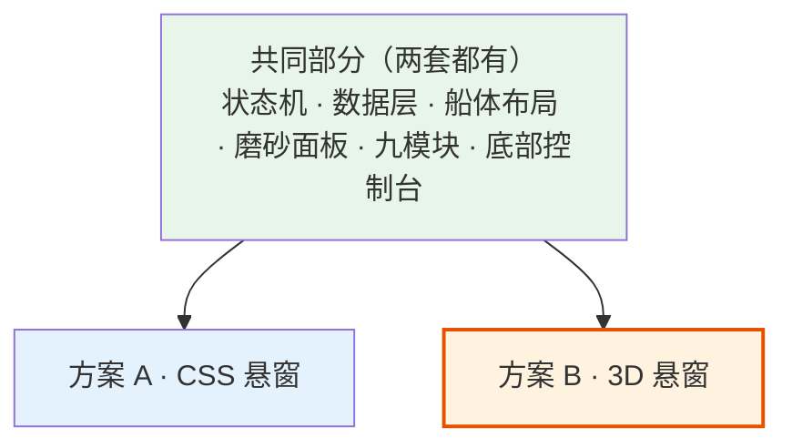

---

### 9.0 一页对比表（先看这个）

| 维度 | 方案 A · CSS 悬窗 | 方案 B · 3D 悬窗 |
|---|---|---|
| **效果** | 渐变星空、颜色随状态变、有深度感 | 真 3D 星海、行星、空间站、星轨 |
| **技术** | 纯 CSS + 少量 DOM | Three.js + `@react-three/fiber` |
| **新增依赖** | 无 | `three` `@react-three/fiber` `@react-three/drei` |
| **首屏体积** | 几乎为 0 | **+500KB ~ 1MB** |
| **上手难度** | ⭐ | ⭐⭐⭐⭐（要懂 3D 坐标、光照、材质） |
| **调参时间** | 中 | **中高**（多了相机、光照、材质） |
| **性能风险** | 低 | 中（有明确规避手段） |
| **调试难度** | 低 | 中（3D 问题难定位） |
| **做到能用** | **1–2 天** | **1–2 周** |
| **上限** | 中 | **高** |
| **能否后续升级** | ✅ 可以平滑换成方案 B | — |

**一句话**：

> **方案 A 是"看起来像舰桥"，方案 B 是"真的是舰桥"。**

---

### 9.1 方案 A · CSS 悬窗

#### 它长什么样

```text
┌────────────────────────────────────────────┐
│  ░░░░░░  深色渐变天空  ░░░░░░             │
│      ·  ·     ·                            │
│   ·      ·  ·    ·      ·                  │
│  ·   ·      ·        ·     ·               │
│       ·  ·      ·  ·                       │
│  ↑ 星星是定位好的 DOM 点，缓慢移动          │
│  ↑ 背景是一个 CSS 渐变，随状态换色           │
└────────────────────────────────────────────┘
```

#### 技术要点

| 层 | 怎么做 |
|---|---|
| 天空 | 一个 `linear-gradient` 背景，颜色按状态从 `SCENES` 表取 |
| 星星 | 几十到几百个绝对定位的 DOM 点（或一层 `radial-gradient` 重复） |
| 流动感 | CSS `animation` 缓慢平移星星层 |
| 状态切换 | `transition: background 2s ease` —— **这一条就是"氛围感"的主力** |

#### 核心代码

```css
/* src/theme/window.css */

/* 天空：颜色由 JS 按状态写进 CSS 变量 */
.window-sky {
  position: fixed;
  inset: 0;
  background: linear-gradient(
    180deg,
    var(--sky-top) 0%,
    var(--sky-mid) 55%,
    var(--sky-bottom) 100%
  );
  /* ★ 这行是氛围感的来源：状态一变，颜色平滑过渡 */
  transition: background 2.5s ease, filter 2s ease;
  filter: brightness(var(--sky-brightness, 1));
}

/* 星星层：一张重复的点阵图，缓慢平移 */
.window-stars {
  position: absolute;
  inset: -50%;              /* 比屏幕大，平移时不会露边 */
  background-image: radial-gradient(1px 1px at 20px 30px, #fff, transparent),
                    radial-gradient(1px 1px at 80px 120px, #fff, transparent),
                    radial-gradient(1.5px 1.5px at 200px 60px, #cfe8ff, transparent);
  background-size: 300px 300px;
  animation: drift 120s linear infinite;
  opacity: var(--star-opacity, 0.6);
}

@keyframes drift {
  from { transform: translate3d(0, 0, 0); }
  to   { transform: translate3d(-300px, -300px, 0); }
}

/* 忙碌时加速、深夜时压暗 */
.window-stars { animation-duration: var(--star-duration, 120s); }
```

```tsx
// src/shell/Window.tsx
import type { SceneSpec } from '../core/scene'

export function Window({ spec }: { spec: SceneSpec }) {
  // 把场景参数写进 CSS 变量 —— 状态一变，样式自动过渡
  const style = {
    '--sky-top':       spec.sky[0],
    '--sky-mid':       spec.sky[1],
    '--sky-bottom':    spec.sky[2],
    '--sky-brightness': String(spec.brightness),
    '--star-opacity':   String(spec.starOpacity),
    '--star-duration':  `${120 / Math.max(spec.driftSpeed, 0.1)}s`,
  } as React.CSSProperties

  return (
    <div className="window-sky" style={style}>
      <div className="window-stars" />
    </div>
  )
}
```

#### 加"行星"怎么办

用 CSS 就行——一个带径向渐变的圆：

```css
.planet {
  position: absolute;
  right: 12%; top: 22%;
  width: 180px; height: 180px;
  border-radius: 50%;
  background: radial-gradient(circle at 32% 30%, #7fb8ff, #1b3a6b 60%, #0a1830);
  box-shadow: 0 0 80px 20px rgba(90, 160, 255, 0.25);
  /* 出现时缓慢放大 */
  animation: planet-in 3s ease forwards;
}
@keyframes planet-in {
  from { transform: scale(0.3); opacity: 0; }
  to   { transform: scale(1);   opacity: 1; }
}
```

**够用了。** 屏幕上就是一个发光的球，看着像行星。

#### 优点 / 代价

| ✅ 优点 | ⚠️ 代价 |
|---|---|
| 1–2 天能做完 | 没有真正的纵深 |
| 零依赖、零体积 | 不能自由转动视角 |
| 不会掉帧 | 星轨、体积星云做不出来 |
| 调试极简单（就是 CSS） | 重复感稍强（星星是平铺的） |
| **随时可换成方案 B** | — |

---

### 9.2 方案 B · 3D 悬窗

#### 它长什么样

```text
┌────────────────────────────────────────────┐
│ ✦   ✧     ✦        ✦      ✧    ✦   ✧      │
│   ✦   ✧      ✦  ✧     ✦   ✧                │
│  ✧      ✦  (行星)  ✦      ✧                │
│    ✦  ✧   ✦     ✦   ✧    ✦                 │
│ ✦    ✧      ✦      ✧   ✦   ✧               │
│ ↑ 真 3D：有距离、有景深、相机可动           │
│ ↑ 忙碌时星星拉成轨迹（warp 效果）           │
└────────────────────────────────────────────┘
```

#### 技术栈

| 包 | 作用 |
|---|---|
| `three` | 3D 引擎本体 |
| **`@react-three/fiber`** | ★ 核心——让 Three.js 用 JSX 写，和 React 状态无缝衔接 |
| `@react-three/drei` | 现成零件：星星、雾、相机控制、性能监控 |

**为什么用 R3F 而不是裸 Three.js**：

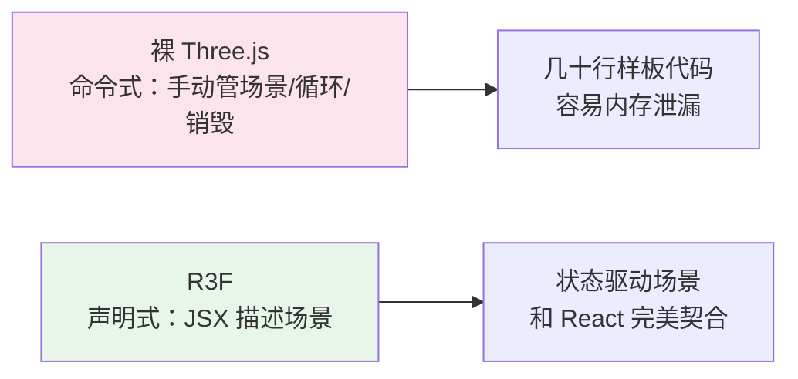

```tsx
// 状态一变，场景自动更新 —— 这就是 R3F 的价值
<Canvas>
  <Starfield speed={spec.driftSpeed} />
  <Planet visible={ambience === 'arrival'} />
  <ambientLight intensity={spec.brightness} />
</Canvas>
```

#### 渲染桥：3D 与状态的唯一接口 ★

**这是方案 B 里最关键的一个设计。** 3D 代码不认识"忙碌"，只认识数字。

```ts
// src/scene3d/bridge.ts —— 两边唯一的接头
import type { SceneSpec } from '../core/scene'

/** 3D 世界懂的东西：只要数字和布尔 */
export interface StageParams {
  starSpeed: number
  starCount: number
  exposure: number
  fogNear: number
  fogFar: number
  showPlanet: boolean
  showStation: boolean
  accentHex: number
}

export function toStageParams(spec: SceneSpec): StageParams {
  return {
    starSpeed:   spec.driftSpeed,
    starCount:   spec.driftSpeed > 1 ? 8000 : 4000,
    exposure:    spec.brightness,
    fogNear:     20 + spec.fogDensity * 30,
    fogFar:      120 - spec.fogDensity * 60,
    showPlanet:  spec.scene === 'new-planet',
    showStation: spec.scene === 'station',
    accentHex:   parseInt(spec.accent.slice(1), 16),
  }
}
```

> 🧠 **一句话记住**：`bridge.ts` 是**翻译官**。状态层说中文，3D 层说数字，翻译官只干这一件事。

**为什么必须有它**：

| 没有它 | 有它 |
|---|---|
| 改个阈值就要动 3D 代码 | 只改 `scene.ts` 那张表 |
| 3D 出问题要怀疑状态算错 | 两边可独立验证 |
| 3D 代码依赖业务概念 | 3D 代码只依赖数字 |

#### 性能：三个杀手与解法

`spacecraft-autopilot`（一个带真实物理引擎的 3D 项目）已验证 **Three.js + React 能跑 60fps**。真正的风险是这三个：

| 杀手 | 为什么会炸 | 怎么躲 |
|---|---|---|
| **全屏 `backdrop-filter` 盖在 canvas 上** | 每帧重新采样 3D 画面做模糊 → 掉帧最狠 | 见下方分层方案 ★ |
| **React 重渲染带动场景重建** | 组件一更新就重建场景 | 场景状态与界面状态**分开**；3D 对象用 `useRef` 持有 |
| **粒子无节制** | 10 万个独立几何体必卡 | 用 `Points` / `InstancedMesh`，几万颗量级没问题 |

#### 关键决策：磨砂不模糊 3D ★

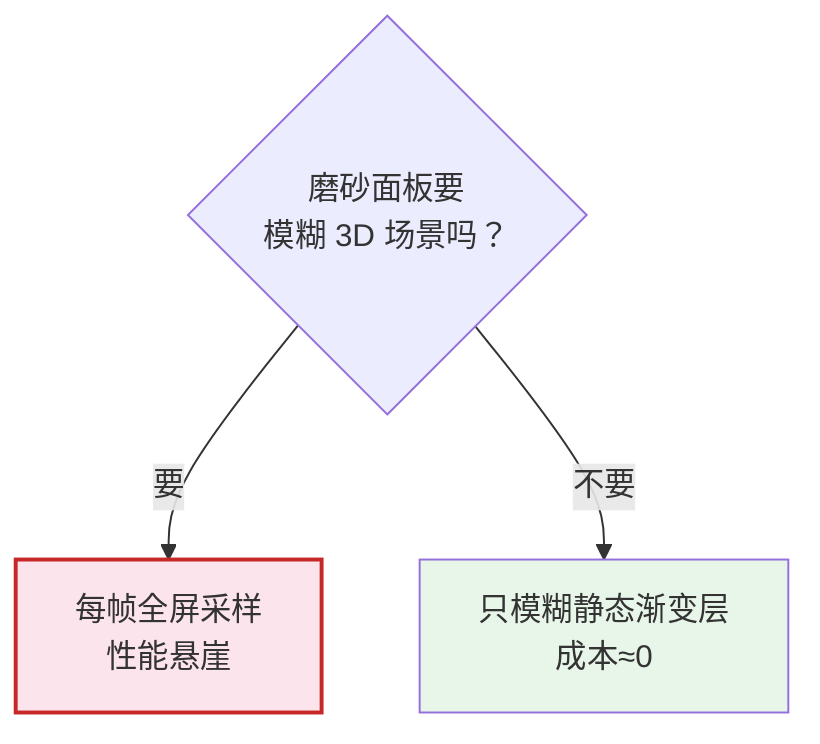

**解法**：面板模糊的是**静态渐变层**，不是 canvas。

```text
层级（从下到上）：
① Three.js canvas      ← 3D 场景
② 静态渐变层           ← 磨砂面板模糊的是这一层，便宜
③ 磨砂面板             ← backdrop-filter 只采样第②层
```

```css
/* ② 静态渐变层：不随动画帧变化，浏览器可缓存 */
.scrim {
  position: fixed; inset: 0;
  background: linear-gradient(
    to bottom,
    rgba(255,255,255,0.02),
    rgba(255,255,255,0.10)
  );
  pointer-events: none;        /* 别挡住 3D 交互 */
}

/* ③ 磨砂面板：模糊的是 ②，不是 canvas */
.panel {
  backdrop-filter: blur(20px) saturate(140%);
  background: rgba(255, 255, 255, 0.08);
}
```

| | 直接模糊 3D | 模糊静态层（选这个） |
|---|---|---|
| 视觉差异 | — | **几乎看不出来** |
| 性能 | 每帧全屏采样 | **几乎为零** |
| 风险 | 高 | 低 |

> 💡 这不是妥协，是正解。真实相机的毛玻璃本来也不是实时模糊外部世界，而是采样一层固定的散射光——我们模拟同一个物理事实。

#### 场景元素与状态对应

| 环境状态 | 3D 场景 | 实现要点 |
|---|---|---|
| **平稳** calm | 安静星海 | 低速度、中等星数、正常曝光 |
| **忙碌** cruising | 高速航行 | 高速度 + **星星拉成轨迹** |
| **完成** arrival | 抵达新行星 | 行星从远处**缓缓放大** |
| **深夜** night | 静谧深空 | 曝光调低、雾变浓、星数减少 |
| **异常** warning | 空间站 + 轻微警示 | 引入空间站；点缀色偏橙；**不闪烁** |

**实现顺序（从便宜到贵）**：

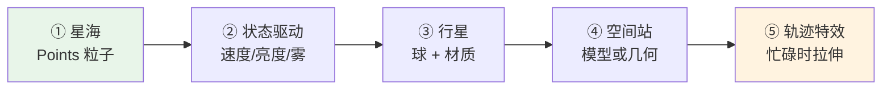

> 💡 **①和②就交付 80% 的效果**。③④⑤是加分项。

#### 3D 专属的三个坑

| 坑 | 说明 | 解法 |
|---|---|---|
| **资源泄漏** | R3F 卸载时几何体/材质/贴图**不会自动释放** | `useEffect` 里清理，或 `dispose` |
| **相机与鼠标** | 视差若监听 `mousemove` 需节流 | 用 `useFrame` 读 ref，**别**在事件里 setState |
| **首屏体积** | Three.js 约 **+500KB~1MB** | 代码分割：悬窗 `React.lazy` 懒加载 |

#### 优点 / 代价

| ✅ 优点 | ⚠️ 代价 |
|---|---|
| 真纵深、真 3D 感 | **1–2 周**才能用 |
| 相机可动、可自由创作 | 三个新依赖，+500KB~1MB |
| 星轨、行星、空间站都好做 | 要学 3D 概念（坐标、光照、材质） |
| 天花板很高 | 调参维度变多（相机、光照、材质） |
| — | 调试更难（3D 问题不好定位） |

---

### 9.3 两套方案的界面观感差异（诚实版）

| 场景 | 方案 A 看到什么 | 方案 B 看到什么 |
|---|---|---|
| 平稳 | 深蓝渐变 + 缓慢移动的星点 | 有景深的星海，远处星星更暗更小 |
| 忙碌 | **颜色变亮 + 星星移动加快** | 星星**拉成光线**，像进入超空间 |
| 完成 | 右下角出现一个发光圆 | 一颗行星**从远到近缓缓放大** |
| 深夜 | 整体压暗、星点变少 | 曝光降低 + 雾变浓，远景淹没 |
| 异常 | 点缀色变橙 | 出现空间站剪影，色调偏警醒 |

**说实话**：在"平稳"和"深夜"这两个状态，**两套看起来差不多**——因为都是"暗+星"。差别主要在"忙碌"（星轨）和"完成"（行星动画）。

> 💡 **推论**：如果你最看重的是"忙碌时有超空间感"，那方案 B 的星轨效果值得那 1–2 周。如果只是"有个变化的星空背景"，方案 A 完全够。

### 9.4 混合方案（第三选择）

如果你觉得两套都不完美，有个折中：

| 做法 | 说明 |
|---|---|
| **先用 A 做完整套** | 外壳、九模块、状态机全做完，悬窗用 CSS |
| **之后单独升级悬窗** | 只替换 `Window.tsx` 内部，其他代码不动 |

**这之所以可行**，正是因为第 3 章那条解耦铁律——**组件只接收 `SceneSpec`，不关心它怎么被画出来**。

```tsx
// 两种实现，对外接口完全一样
<Window spec={spec} />   // 内部是 CSS
<Window spec={spec} />   // 内部是 R3F
```

**所以我建议**：**先按方案 A 做到"整套能跑"，再决定要不要上 B。** 这不是拖延——而是**用最低成本先验证"状态驱动氛围"这条核心链路对不对**。

---

### 9.5 渐进路线（两套都适用）

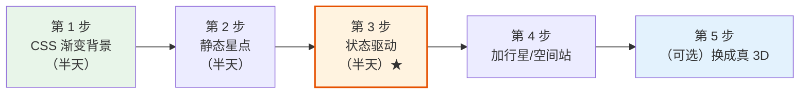

**第 3 步是分水岭**：

- 在它之前，悬窗只是个"好看的静态背景"
- 在它之后，它才是**状态的显示器**

而第 1–3 步**用方案 A 的技术就能全部完成**，且只需 **1–2 天**。第 5 步（换 3D）可以等一切稳定后再做。

> ⚠️ **顺序绝对不能反**：**状态机必须在悬窗之前**。
> 悬窗是"状态的显示器"。状态算错了，画面调得再漂亮也是在显示错误的东西。

## 10. 边缘面板与磨砂

### 界面分区

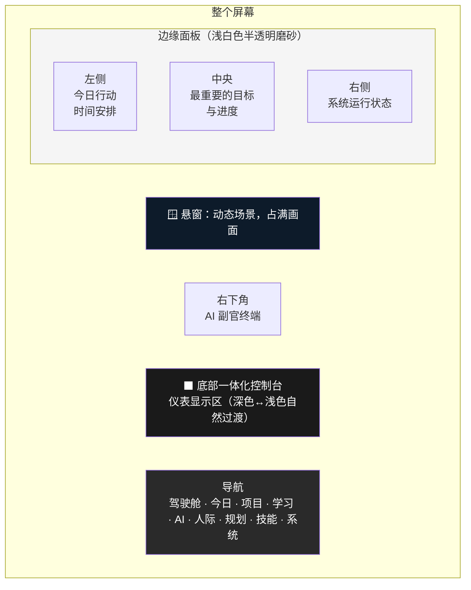

### 布局原则（来自你的设想）

| 原则 | 怎么做 |
|---|---|
| **不遮挡中央景观** | 面板只在**边缘和下方**，中央留白 |
| 浅白半透明磨砂 | `backdrop-filter: blur(...)` + 半透明白底 |
| 大块明暗对比 | 哑光黑 / 钛灰 / 陶瓷白，三种基调 |
| 少量青蓝点缀 | 只在"标记当前状态"时用，**不要到处用** |
| 深色↔浅色过渡 | 仪表显示区用渐变，不要硬边界 |

### 磨砂面板的代码

```css
/* src/theme/effects.css */
.panel {
  /* 半透明白底 + 背景模糊 = 磨砂玻璃 */
  background: rgba(255, 255, 255, 0.08);
  backdrop-filter: blur(20px) saturate(140%);
  -webkit-backdrop-filter: blur(20px) saturate(140%);

  /* 极细的亮边，让它"浮"在星空上 */
  border: 1px solid rgba(255, 255, 255, 0.12);
  border-radius: 14px;

  /* 轻微内阴影，制造厚度感 */
  box-shadow: inset 0 1px 0 rgba(255, 255, 255, 0.08);
}
```

> ⚠️ **一个容易踩的坑**：`backdrop-filter` 只对**它背后的内容**生效。如果祖先元素设了 `filter` 或 `transform`，模糊会失效或错位。所以**别给面板的祖先元素加 `filter`**。

## 11. 底部控制台与九个导航

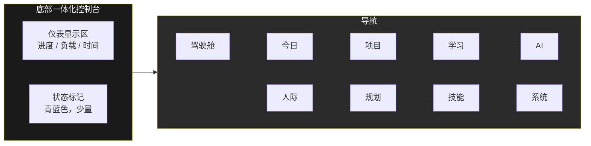

**九个导航模块 = 九个页面**。点一个，中间的舱室内容换掉，**悬窗保持不变**——船的"窗外"不会因为你看别的舱室而改变。

---

# 第五部分 · 前端怎么实现

## 12. 技术栈

### 12.1 两套方案都用的（核心）

| 技术 | 是什么 | 为什么选它 |
|---|---|---|
| **React** | 做界面的工具 | 最主流，资料最多 |
| **TypeScript** | 带类型检查的 JS | 写错当场报错 |
| **Vite** | 开发服务器 + 打包 | 启动快，配置少，适合独立应用 |
| **Zustand** | 状态管理（很小） | 比 Redux 简单太多，小白友好 |
| **CSS 变量 + CSS Modules** | 样式 | 磨砂/暗色要精确控制，CSS 最直接 |
| **`motion`**（Framer Motion） | 组件进出、布局动画 | React 生态事实标准 |

### 12.2 悬窗按需选（见 §9）

| 方案 | 装什么 | 体积 |
|---|---|---|
| **A · CSS 悬窗** | **什么都不用装** | 0 |
| **B · 3D 悬窗** | `three` + `@react-three/fiber` + `@react-three/drei` | +500KB ~ 1MB |

> 💡 **这是唯一的依赖差异**。其余部分两套完全一样——所以先做 A 再升级到 B，**不用改架构**。

### 12.3 图表（可选）

| 技术 | 用在哪 |
|---|---|
| **`recharts`** | 学习时长的统计图、技能雷达图 |

**只在需要图表的页面装**，用动态 `import` ——不画图的页面不必加载它。

### 为什么不用 CSS 框架（Tailwind 之类）

不是不能用，而是**舰桥的视觉高度定制**（磨砂、光晕、渐变、多层叠加），CSS 变量 + 自定义类反而更清楚。

而且——**所有设计变量集中在一个文件**，将来换配色只改那里。

```css
/* src/theme/tokens.css */
:root {
  /* 三种基调 */
  --matte-black:  #0e0e10;
  --titanium:     #3a3d42;
  --ceramic:      #f2f1ed;

  /* 唯一的点缀色，通过 JS 按状态覆盖 */
  --accent:       #4fc3f7;

  /* 磨砂与间距 */
  --blur:         20px;
  --radius:       14px;
  --gap:          16px;

  /* 字体 */
  --font-ui:      system-ui, -apple-system, 'Segoe UI', sans-serif;
  --font-mono:    'JetBrains Mono', ui-monospace, monospace;
}
```

> ⚠️ **`--accent` 是唯一的点缀色**。你的设想写的是"**少量**青蓝标记当前状态"——所以这个变量**只在少数几处用**，别到处洒。这是"克制"和"廉价科幻"的分界线。

## 13. 怎么分层解耦

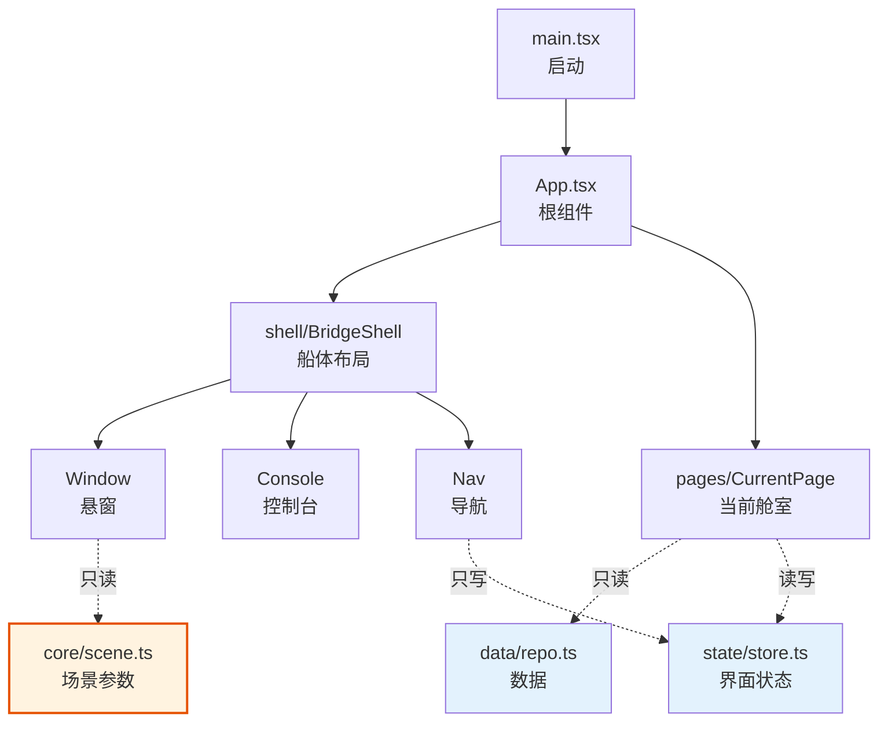

### 三条解耦铁律

**铁律 1：`core/` 里没有 React**

```ts
// ✅ core/ambience.ts —— 纯函数，可以在 node 里直接跑
export function deriveAmbience(input: AmbienceInput): Ambience { ... }

// ❌ 绝不在 core 里出现：
import { useState } from 'react'   // ← 不许
```

**好处**：逻辑能单独测试，不用打开浏览器。

**铁律 2：组件不认识数据细节**

```tsx
// ❌ 错误：组件自己去算业务
function StatusPanel({ goals, actions }) {
  const overdue = goals.filter(g => !g.done && isPast(g.due)).length   // ← 组件里算业务
  // ...
}

// ✅ 正确：外面算好，组件只画
function StatusPanel({ ambience, spec }: { ambience: Ambience; spec: SceneSpec }) {
  return <div style={{ color: spec.accent }}>{ambience}</div>
}
```

**大白话**：仪表盘不该自己去测油量，它只负责显示油量表的指针位置。

**铁律 3：只有 `data/repo.ts` 碰存储**

```ts
// ✅ 所有读写都走这一层
// data/repo.ts
export const repo = {
  listGoals:     (): Goal[] => { ... },
  saveGoal:      (g: Goal): void => { ... },
  listActionsOn: (date: string): Action[] => { ... },
}

// ❌ 组件里不许出现
localStorage.getItem('goals')   // ← 不许，应该走 repo
```

**好处**：将来从 localStorage 换成 IndexedDB 换云端，**只改一个文件**。

### 一张图看清"数据怎么流"

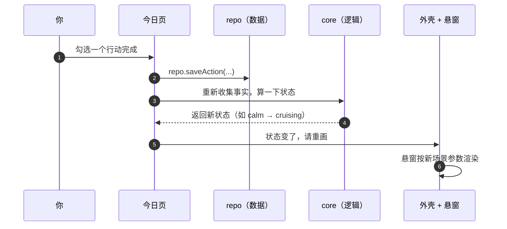

## 14. 九个模块的信息架构

| 模块 | 展示什么 | 主要数据 |
|---|---|---|
| **驾驶舱** | 总览：最重要的目标 + 今日进度 + 系统状态 | 全部（聚合） |
| **今日** | 今天的行动清单、时间安排、勾选完成 | Action |
| **项目** | 项目列表、状态、关联目标 | Project, Goal |
| **学习** | 学习记录、时长统计、主题分布 | StudySession |
| **AI** | AI 副官终端（对话） | 可选，见第 17 章 |
| **人际** | 联系人、上次联系、该联系谁 | Person |
| **规划** | 年/季/月/周目标的树状关系 | Goal |
| **技能** | 技能等级、练习记录、雷达图 | Skill |
| **系统** | 设置：主题、数据导入导出、状态阈值 | 配置 |

> 💡 **「驾驶舱」不做新东西**，它只是把其他模块的信息**聚合**展示。所以它可以**最后做**。

---

# 第六部分 · 数据怎么放

## 15. 数据模型

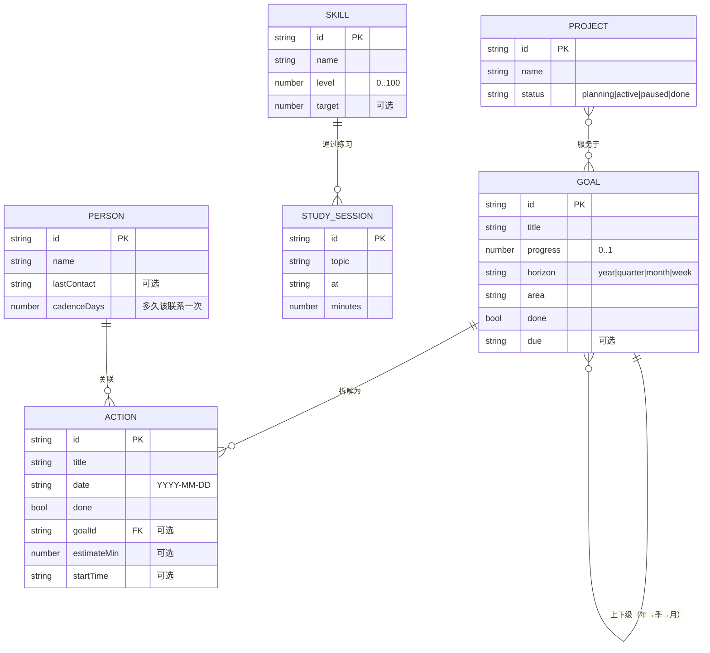

### 完整类型

```ts
// src/data/types.ts

export type Horizon = 'year' | 'quarter' | 'month' | 'week'

export interface Goal {
  id: string
  title: string
  progress: number          // 0..1
  horizon: Horizon
  area: string              // 属于哪个领域（事业/健康/…）
  done: boolean
  due?: string              // YYYY-MM-DD
  parentId?: string         // 上一层目标（年 → 季）
}

export interface Action {
  id: string
  title: string
  date: string              // YYYY-MM-DD
  done: boolean
  goalId?: string
  estimateMin?: number
  startTime?: string        // HH:mm
}

export interface Project {
  id: string
  name: string
  status: 'planning' | 'active' | 'paused' | 'done'
  goalIds: string[]
}

export interface Skill {
  id: string
  name: string
  level: number             // 0..100
  target?: number
}

export interface StudySession {
  id: string
  topic: string
  at: string                // ISO 时间
  minutes: number
}

export interface Person {
  id: string
  name: string
  lastContact?: string
  cadenceDays?: number
}

/** 所有数据的容器 */
export interface AppData {
  goals: Goal[]
  actions: Action[]
  projects: Project[]
  skills: Skill[]
  sessions: StudySession[]
  people: Person[]
}

/** 环境状态（放在这里，因为它也是"数据"的一部分） */
export type Ambience = 'calm' | 'cruising' | 'arrival' | 'night' | 'warning'
```

> ⚠️ **一个设计决定**：`Action` 用 `date: 'YYYY-MM-DD'` 字符串，**不用 Date 对象**。因为 JSON 存不了 Date，字符串最省事，排序也方便。

## 16. 存储方案

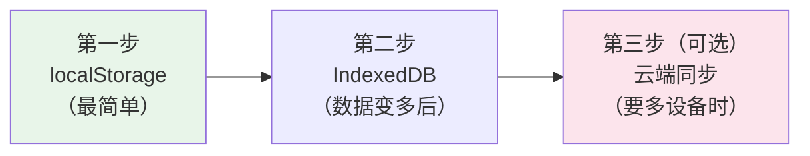

| 阶段 | 用什么 | 什么时候该换 |
|---|---|---|
| 1 | **localStorage** | 数据量小（< 5 MB）时完全够用 |
| 2 | **IndexedDB** | 记录上千条、或想存图片时 |
| 3 | 云端 | 要在多设备间同步时 |

**关键**：因为所有读写都在 `data/repo.ts` 里，**换存储只改那一个文件**，其他代码一行不动。

```ts
// src/data/repo.ts —— 唯一的存储出口

import type { AppData, Goal, Action } from './types'

const KEY = 'bridge-ui:data'

function emptyData(): AppData {
  return { goals: [], actions: [], projects: [], skills: [], sessions: [], people: [] }
}

function readAll(): AppData {
  const raw = localStorage.getItem(KEY)
  if (!raw) return emptyData()
  try {
    return JSON.parse(raw) as AppData
  } catch {
    return emptyData()      // 数据坏了也别崩，给一份空的
  }
}

function writeAll(data: AppData): void {
  localStorage.setItem(KEY, JSON.stringify(data))
}

export const repo = {
  all: readAll,

  listGoals: (): Goal[] => readAll().goals,

  saveGoal: (g: Goal): void => {
    const d = readAll()
    const i = d.goals.findIndex(x => x.id === g.id)
    if (i >= 0) d.goals[i] = g
    else d.goals.push(g)
    writeAll(d)
  },

  listActionsOn: (date: string): Action[] =>
    readAll().actions.filter(a => a.date === date),

  /** 逾期数量 —— 环境状态机要用 */
  overdueCount: (today: string): number =>
    readAll().actions.filter(a => !a.done && a.date < today).length,
}
```

## 17. AI 副官终端 ★

### 17.1 先分清两件事：桌宠式 vs 副官式

它长得像桌宠（屏幕一角一个常驻小家伙），但**桌宠和副官差一个关键维度——上下文权**：

| | 桌宠式 | 副官式 |
|---|---|---|
| 位置 | 右下角悬浮面板 | 右下角悬浮面板 |
| 形态 | 常驻小角色 | 常驻小角色 |
| 交互 | 点一下对话 | 点一下对话 |
| **知道你的数据吗** | ✅ 知道 | ✅ 知道 |
| **能替你改数据吗** | ❌ **不能，只会说** | ✅ **能，会动手** |
| 复杂度 | 低 | 中高 |
| 什么时候做 | **可以早做** | **必须最后做** |

### 17.2 为什么副官式那么强

因为舰桥的状态来自你自己的数据，副官可以做到桌宠**结构上做不到**的事：

> 副官说"你今天三个目标都逾期了，要不要重排一下？"
> 然后**它自己把行动挪了**，背景的 `warning` 状态随之变回 `calm`。

**桌宠是个挂在编辑器上的挂件，副官是舰桥的一个器官。**

### 17.3 我们的路线：先桌宠，后续升级

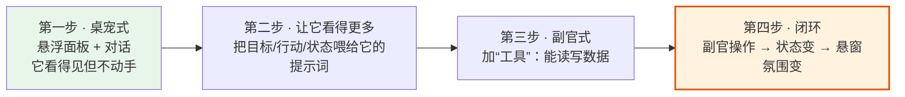

**为什么要分步**：桌宠式是**纯前端**（一个面板 + 一次 API 调用）；副官式需要**工具调用循环 + 权限**。先做前者，能立刻看到东西；后者是另一个量级。

### 17.4 第一步：桌宠式怎么实现

**形态**：

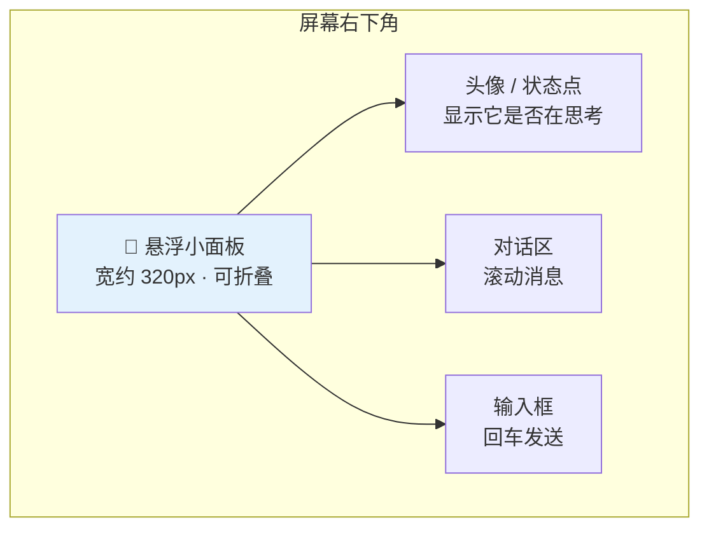

**关键设计点**：

| 设计点 | 怎么做 | 为什么 |
|---|---|---|
| **不抢焦点** | 固定定位 `position: fixed`，可折叠成一个圆点 | 它是副官，不是主界面 |
| **带上上下文** | 每次请求把「现在状态 + 今日行动摘要」塞进提示词 | **这是它区别于普通聊天框的地方** |
| **响应流式** | 逐字显示，不要等完整回答 | 体感差别巨大 |
| **失败要好懂** | 网络断了说"联系不上总部"，不要抛英文栈 | 小白友好 |

**上下文怎么带**（这是灵魂）：

```ts
// src/core/pet-context.ts
// 把"舰桥现在长什么样"翻译成一段话，喂给 AI

import type { Ambience } from './ambience'
import type { Action, Goal } from '../data/types'

export function buildPetContext(input: {
  ambience: Ambience
  todayActions: Action[]
  topGoals: Goal[]
  overdueCount: number
}): string {
  const { ambience, todayActions, topGoals, overdueCount } = input

  const mood = {
    calm:     '舰桥处于平稳航行状态，一切正常。',
    cruising: '舰桥处于高速航行状态，今天任务较重。',
    arrival:  '刚刚完成一个重要目标，舰桥正在庆祝。',
    night:    '现在是深夜，舰桥切换到了静谧深空模式。',
    warning:  '舰桥出现了环境警示：逾期任务偏多。',
  }[ambience]

  const todo = todayActions.filter(a => !a.done).map(a => a.title)
  const done = todayActions.filter(a => a.done).length

  return [
    mood,
    `今天已完成 ${done} 项，待办：${todo.length ? todo.join('、') : '无'}。`,
    overdueCount > 0 ? `有 ${overdueCount} 项已经逾期。` : '',
    topGoals.length
      ? `当前重点目标：${topGoals.map(g => `${g.title}（${Math.round(g.progress * 100)}%）`).join('、')}。`
      : '',
  ].filter(Boolean).join('\n')
}
```

**喂进去之后，副官就能说人话了**：

> 普通聊天框："你好，有什么可以帮你？"
> 带上上下文："舰桥在平稳航行。今天 5 项任务还剩 2 项，重点目标是「季度复盘」到 60% 了。要不要先把剩下的收了？"

### 17.5 第三步：升级成副官式

升级 = **给它"手"**。加一个工具调用循环：

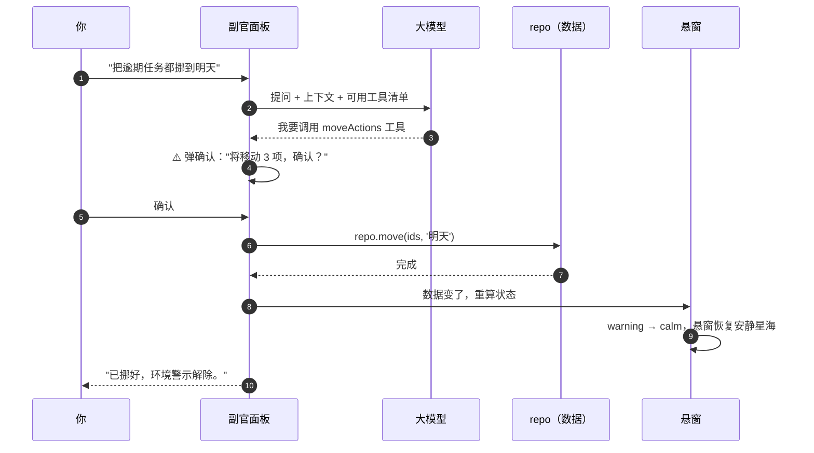

**⚠️ 副官式必须有的三条安全线**：

| 安全线 | 为什么 |
|---|---|
| **每一个写操作都要确认** | AI 会理解错。改数据不可逆时必须问 |
| **工具清单要最小** | 只给它该有的能力，不要图省事全开 |
| **操作要能撤销** | 每次改动前留一份快照 |

> 💡 **这条设计正好可以复用你在另一个项目（dsh）里学到的东西**：dsh 的审批机制就是"危险操作先问"。同一个思路，这里手动实现一遍即可。

### 17.6 三种接法（技术选型）

| 方案 | 怎么做 | 什么时候选 |
|---|---|---|
| **先不做** | 面板占位，显示一句固定话 | 想先跑通舰桥本体 |
| **直连大模型 API** | `fetch` 调 OpenAI 兼容接口 | 需求简单、不想引入别的 |
| **接 dsh** | dsh 有 headless 模式和 SDK，让它干 AI 的活 | 想复用 dsh 的 agent + 工具 + 审批 |

**推荐顺序**：

1. 先把面板做出来（**纯 UI，不接任何 AI**）——能折叠、能输入、能显示假回复
2. 再接大模型 API（一次 `fetch`，最简单）
3. 只有当你需要"副官能调很多工具"时，才考虑接 dsh

> ⚠️ **API 密钥不能写在前端代码里**。前端代码是公开的。正确做法：
> - 要么让用户自己在设置里填（存在本地）
> - 要么走一个自己的小后端中转
>
> 这是新手最容易犯的安全错误。

### 17.7 什么时候做

| 阶段 | 做什么 | 前提 |
|---|---|---|
| 模块 6 之后 | **面板 UI**（纯界面，假数据） | 船体布局完成 |
| 模块 9 之间 | **接大模型 + 带上下文** | 数据层稳定 |
| 模块 10 或之后 | **副官式（工具调用）** | 所有模块都完成 |

> 💡 **一句话**：**面板可以早做（便宜、见效快），动手能力必须晚做（依赖全部数据层）。**

---

# 第七部分 · 动手做

## 18. 开发顺序：第一个模块做什么，以此类推 ★

> **原则**：每一步都要**能看到东西**。看不到就先别往下走——否则出问题时你分不清是哪一步坏的。

### 模块 1 · 空壳 + 纯色背景（能看到一个页面）

**做什么**
- `npm create vite@latest bridge-ui -- --template react-ts` 建项目
- 写 `main.tsx` 和 `App.tsx`，渲染一个全屏的纯色 div
- 建 `theme/tokens.css`，把三种基调色定下来

**做完能看到**：浏览器打开是一个全屏的深色画面。

**为什么第一步做这个**：先确认工具链通了。

---

### 模块 2 · 数据模型 + 假数据（能"有"数据）

**做什么**
- 写 `data/types.ts`（第 15 章那些接口）
- 写 `data/repo.ts`（先用 localStorage）
- 写 `data/seed.ts`：造几条示例目标、行动

**做完能看到**：控制台里打印出几条假数据。

**为什么第二步做这个**：后面所有东西都读数据，先把数据源立起来。

---

### 模块 3 · 环境状态机（心脏能跳）★

**做什么**
- 写 `core/ambience.ts`（第 7 章那个纯函数）
- 写 `core/scene.ts`（第 8 章那张映射表）
- **写单元测试**：凌晨 3 点该是 `night`，逾期 6 个该是 `warning`

**做完能看到**：测试全部通过。**这是整个项目最值得写测试的地方。**

**为什么这么早做**：它是纯函数，最容易做对，而且后面所有视觉都依赖它。**先把它做对，再让它好看。**

---

### 模块 4 · 悬窗第一步：CSS 悬窗（能看到氛围）

> 🎯 **这一步两套方案都做同一件事**——用最简单的 CSS 让"Theme"能随状态变。
> 这是**方案 A 的全部**，也是**方案 B 的第 1 步**。所以无论如何都先做它。

**做什么**
- 写 `shell/Window.tsx` + `theme/window.css`
- **CSS 渐变天空 + 一层重复的星点**（见 §9.1 的代码）
- 按 `SCENES[ambience]` 写 CSS 变量；用 `transition` 做平滑过渡

**做完能看到**：改一下 seed 数据，背景颜色/亮度会**平滑地变**。

**为什么这时候做悬窗**：它是"氛围"的载体。哪怕只是颜色变，**这一步就能验证整条链路（数据 → 状态 → 视觉）通了**。

**⚠️ 关键**：**如果你只做到这里就停，舰桥也是能用的**——它就是方案 A。

---

### 模块 5 · 舰桥外壳布局（能看到船体）

**做什么**
- 写 `shell/BridgeShell.tsx`：悬窗 + 左中右面板 + 底部控制台
- 写 `components/Panel.tsx`：磨砂面板
- **加一层 `.scrim` 静态渐变**（见 §9.2），让磨砂面板有东西可模糊
- 布局原则：**面板贴边，中央留空**

**做完能看到**：一个像驾驶舱的框架出来了，中间是星空。

---

### 模块 6 · 底部控制台 + 九个导航（能切换）

**做什么**
- 写 `shell/Console.tsx` 和 `shell/Nav.tsx`
- 写 `state/store.ts`：记住"当前在哪个模块"
- 九个页面先都只放一行字

**做完能看到**：点导航能切换中间的内容，**悬窗不变**。

---

### 模块 7 · 第一个真页面：今日（有真功能了）

**做什么**
- `pages/TodayPage.tsx`：今日行动清单，能勾选完成
- 勾选后写回 `repo`，界面自动刷新
- 勾选不改变环境状态（除非全部完成）

**做完能看到**：能记录今天的行动，**刷新页面后还在**。

**为什么先做「今日」**：它是数据最单纯、使用频率最高的模块。用它验证"读写 → 界面更新"这条闭环。

---

### 模块 8 · 悬窗升级（二选一）★

**到这里你已经有一个完整可用的舰桥了。** 现在决定悬窗要不要升级：

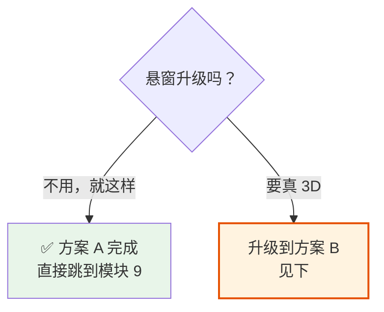

#### 方案 B · 第 1 步：R3F 骨架

**做什么**
- 装 `three` `@react-three/fiber` `@react-three/drei`
- 写 `scene3d/BridgeCanvas.tsx`：一个 `<Canvas>` + 几百颗星
- 写 `scene3d/bridge.ts`：**状态 → 3D 参数的翻译层**（见 §9.2）
- `Window.tsx` 内部换成 `<BridgeCanvas />`（**对外接口不变**）

**做完能看到**：真的 3D 星空，相机可以动。

**坑**：先解决**资源释放**和**首屏体积**（用 `React.lazy` 懒加载），见 §9.2。

#### 方案 B · 第 2 步：状态驱动 3D

**做什么**
- 把 `bridge.ts` 的输出接进场景：速度、星数、曝光、雾
- 用 `useFrame` 做插值，让变化**平滑**而不是跳变

**做完能看到**：勾完一半任务，星空**明显加速**。

**⚠️ 这是方案 B 的分水岭**：在此之前 3D 只是个"好看的屏保"，在此之后它才是**状态的显示器**。

#### 方案 B · 第 3 步（可选）：行星与空间站

**做什么**
- `Planet.tsx`：一个球 + 材质，完成时从远到近放大
- `Station.tsx`：异常时出现
- `effects/WarpEffect.tsx`：忙碌时的星轨

**做完能看到**：完整的状态场景库。

---

### 模块 9 · 其余八个模块（填内容）

按这个顺序，**从简单到复杂**：

| 顺位 | 模块 | 为什么这个顺序 |
|---|---|---|
| 1 | 项目 | 结构简单，和今日类似 |
| 2 | 技能 | 加一个雷达图/进度条 |
| 3 | 学习 | 加统计图表 |
| 4 | 人际 | 加"该联系谁"的推导 |
| 5 | 规划 | 目标树，复杂度上升 |
| 6 | 系统 | 设置项，收尾 |
| 7 | 驾驶舱 | **最后做**，因为它聚合所有 |
| 8 | AI 副官 | 面板可早做（模块 6 后），动手能力放最后。见 §17 |

> 💡 **AI 副官有单独的节奏**（见 §17.7）：**面板 UI 可以早做**（纯界面，便宜、见效快），**但"能动手改数据"必须等所有模块完成**——因为它依赖全部数据层。

---

### 模块 10 · 打磨

- 悬窗升级（若选方案 B）：行星、空间站、星轨
- 深色↔浅色过渡、光晕
- 数据导入导出
- 键盘快捷键

### 模块顺序一览

```mermaid
flowchart LR
    M1["1 空壳"] --> M2["2 数据"] --> M3["3 状态机★"] --> M4["4 CSS悬窗"] --> M5["5 船体"]
    M5 --> M6["6 导航"] --> M7["7 今日页"] --> M8{"8 悬窗升级？"} --> M9["9 八个模块"] --> M10["10 打磨"]
    M8 -->|"方案A：就此打住"| M9
    M8 -->|"方案B：上 3D"| B1["B1 R3F骨架"] --> B2["B2 状态驱动★"] --> B3["B3 行星/空间站"] --> M9
    M3 -.-> KEY["整个应用的心脏<br/>先做对，再做好看"]

    style M3 fill:#fff3e0,stroke:#e65100,stroke-width:2px
    style KEY fill:#fce4ec
    style M8 fill:#e3f2fd
    style B2 fill:#fff3e0,stroke:#e65100,stroke-width:2px
```

> ⭐ **最重要的一条顺序**：**模块 3（状态机）在模块 4（视觉）之前**。
> 先把"什么时候该显示什么"想清楚并测对，再考虑"怎么好看"。反过来做，你会反复返工。

> 🎯 **第二重要的**：**模块 8 是个岔路口，不是必经之路**。
> 到模块 7 结束，你已经有一个完整可用的舰桥了。要不要上 3D，那时再决定——**因为那时你才知道自己满不满意**。

## 19. 分阶段实施（更粗的视角）

```mermaid
flowchart LR
    S0["阶段 0<br/>能跑起来"] --> S1["阶段 1<br/>数据 + 状态机"] --> S2["阶段 2<br/>船体 + 悬窗"]
    S2 --> S3["阶段 3<br/>九个模块"] --> S4["阶段 4<br/>动效打磨"] --> S5["阶段 5<br/>AI 副官（可选）"]
    S2 -.-> OPT["阶段 2.5（可选）<br/>悬窗升级成 3D"]

    style S1 fill:#fff3e0,stroke:#e65100,stroke-width:2px
    style S2 fill:#e8f5e9
    style OPT fill:#e3f2fd
```

| 阶段 | 交付 | 验收 |
|---|---|---|
| **0** | Vite 项目跑起来 | 浏览器能看到一个全屏深色画面 |
| **1** | 数据 + 状态机 + 测试 | 状态机测试全绿；改数据能看到状态变 |
| **2** | 船体布局 + 悬窗（静态） | 像驾驶舱了，背景随状态变色 |
| **3** | 九个模块 | 每个模块都能读写真数据 |
| **4** | 动态星海 + 动效 | 忙碌时背景明显加速 |
| **5** | AI 副官 | 可选 |

---

# 第八部分 · 边界与风险

## 20. 风险与坑

| # | 风险 | 怎么躲 |
|---|---|---|
| R1 | **`backdrop-filter` 失效** —— 祖先元素有 `filter`/`transform` 时会错位或失效 | 别给面板的祖先加 `filter`；必要时用独立层 |
| R2 | **性能**：全屏模糊 + Canvas 动画 + React 重渲染，三样叠加会卡 | 悬窗渲染**独立于 React**（用 ref 直接操作 canvas），别让它跟着 React 重渲染 |
| R3 | **状态抖动**：状态在边界反复横跳 | 加**迟滞**（见下） |
| R4 | **深夜判定用本地时区**，跨时区/改系统时间会乱 | 明确用本地时间，并在设置里可调时段 |
| R5 | **localStorage 上限约 5 MB** | 数据量上来按第 16 章换 IndexedDB |
| R6 | **数据损坏**（JSON 解析失败）导致白屏 | `repo` 里 try/catch，坏了给空数据（第 16 章已示范） |
| R7 | **过度动画**让界面显得廉价 | 动效要"少而准"：只有状态变化时才明显动 |
| R8 | **一上来就优化**（过早调参、过早做特效） | 先把状态机和布局做对，**再考虑好看**（见 §22.2） |
| R9 | **颜色到处硬编码** | 全部走 `theme/tokens.css` 的 CSS 变量 |
| R10 | **组件里写业务逻辑** | 遵守第 13 章三条铁律 |
| **R11** | **3D 资源泄漏**——R3F 卸载时几何体/材质/贴图不会自动释放 | `useEffect` 里 `dispose`，或用 drei 的自动清理组件 |
| **R12** | **3D 全屏模糊叠 canvas**——每帧全屏采样，掉帧最狠 | 磨砂模糊**静态层 `.scrim`**，不模糊 canvas（§9.2） |
| **R13** | **React 重渲染带动 3D 场景重建** | 场景状态与界面状态分开；3D 对象用 `useRef` 持有；`useFrame` 里读 ref，别 setState |
| **R14** | **Three.js 首屏体积 +500KB~1MB** | 悬窗用 `React.lazy` 懒加载，代码分割 |
| **R15** | **粒子无节制**（10 万个独立几何体必卡） | 用 `Points` / `InstancedMesh`，控制在几万量级 |
| **R16** | **3D 调试困难**（问题不好定位） | 先做方案 A 验证链路；3D 出问题时用 `bridge.ts` 的输出值比对状态机 |

### 特别提醒 R3：状态迟滞

```ts
// 问题：任务是 5 个时，第 3 个完成 → 剩 2 个 → 不忙了
//       又不小心取消勾选 → 剩 3 个 → 又忙了
//       状态反复横跳，背景闪个不停

// 解法：进入和退出用不同阈值
const busyEnter = 0.5   // 剩余 ≥ 50% 才进入"忙碌"
const busyExit  = 0.35  // 剩余 < 35% 才退出"忙碌"
```

## 21. 验收清单

- [ ] 状态机能通过单元测试（凌晨→深夜、逾期多→异常、刚完成→完成）
- [ ] 改 `seed.ts` 的数据，界面氛围跟着变
- [ ] 勾选今日行动，刷新后还在
- [ ] `core/` 里没有任何 React import
- [ ] 所有颜色来自 `theme/tokens.css`，没有散落的硬编码色值
- [ ] 所有存储读写都在 `data/repo.ts`，组件里没有 `localStorage`
- [ ] 面板不遮挡中央景观
- [ ] 悬窗动画不引起 React 重渲染
- [ ] 九个导航都能切换，悬窗保持不变
- [ ] 断网可用（纯本地）

## 22. 成本拆解：这活儿到底有多重

这一章回答一个最实际的问题：**要花多少时间，难在哪**。

### 22.1 难度不在"会不会写"，在"要调多久"

```mermaid
flowchart LR
    A["单个效果<br/>都不难"] --> B["但要同时成立"]
    B --> C["性能"]
    B --> D["调参"]
    B --> E["状态耦合"]
    style E fill:#fce4ec,stroke:#c62828
    style C fill:#fff3e0
    style D fill:#fff3e0
```

| 难点 | 具体是什么 | 为什么难 |
|---|---|---|
| **性能** | 全屏模糊 + 3D 动画 + React 重渲染 | 三样都是重活，**叠加会掉帧**（单个都不难） |
| **调参** | 磨砂多糊、亮度多少、青蓝用几分 | **没有标准答案，全靠肉眼反复试** |
| **状态耦合** | 状态一变，整个画面跟着变 | 容易做成一变就"闪" |

### 22.2 调参是最大的无底洞

**一个面板可能就要试 20 遍**：

| 你想要 | 实际要调的参数 |
|---|---|
| "浅白色半透明磨砂" | `alpha`（0.06? 0.08? 0.12?）、`blur`（16? 20? 24?）、`saturate`、边框亮度宽度、内阴影 |
| "深色↔浅色自然过渡" | 渐变起止位置、色标数量、过渡曲线 |
| "少量青蓝标记" | 用在哪几处、亮度多少、要不要发光 |

**关键洞察**：调参成本**不随页面数量增长**——只要在第一个页面就把变量定死。

| 做法 | 总成本 |
|---|---|
| ❌ 每个页面各调一遍 | 9 × 20 ≈ **180 次** |
| ✅ 第一页调好，抽成 CSS 变量 | 20 + 8 ≈ **28 次** |

**差 6 倍。**

### 22.3 按成本拆：哪些贵，哪些便宜

| 效果 | 难度 | 成本 | 建议 |
|---|---|---|---|
| 纯色背景 + 文字排版 | ⭐ | 低 | 立刻做 |
| 磨砂面板 | ⭐⭐ | 低 | 立刻做（注意祖先不能有 `filter`） |
| CSS 渐变天空随状态变 | ⭐⭐ | 低 | 立刻做，**这是氛围感主力** |
| 卡片 / 进度条 | ⭐⭐ | 低 | 立刻做 |
| CSS 星点层 | ⭐⭐ | 低 | 立刻做 |
| **R3F 骨架（3D 场景能跑）** | ⭐⭐⭐ | **中** | 方案 B 第 1 步 |
| **3D 状态驱动** | ⭐⭐⭐ | **中** | 方案 B 第 2 步，**分水岭** |
| 弧形仪表 / 雷达 | ⭐⭐⭐ | 中 | **借现成库** |
| 行星 / 空间站模型 | ⭐⭐⭐ | 中 | 方案 B 第 3 步 |
| **星轨 / 体积星云** | ⭐⭐⭐⭐ | **高** | 谨慎 |
| 开机动画 | ⭐⭐⭐ | 中 | 借库，**最后做** |

**规律**：

> **凡是"整屏级"的效果（全屏模糊、全屏 3D 光照），成本陡增。**
> **凡是"局部"的效果（一个面板、一个仪表、一个圆），成本可控。**

### 22.4 一条重要的推论

**你其实不需要那么多动画。** 回到原始设想，真正"动"的只有悬窗的场景变化。

而这件事——**换背景色 / 亮度 / 雾浓度**——**方案 A 用 CSS 过渡就够了**：

```css
.window-sky { transition: background 2.5s ease, filter 2s ease; }
```

**这就是最小可行的"氛围感"**，1–2 天能做完，效果不差。

### 22.5 保守路线（省一半工作量）

| 砍掉 | 保留 |
|---|---|
| ❌ 3D / WebGL | ✅ CSS 渐变背景随状态变 |
| ❌ 全屏动态模糊 | ✅ 局部磨砂面板 |
| ❌ 多层视差 | ✅ 状态切换的柔和过渡 |
| ❌ 复杂粒子 | ✅ 少量 CSS 星点 |
| ❌ 开机动画 | ✅ 卡片进出动画 |

**结果**：依然是"舰桥"，依然有"氛围随状态变"的核心体验，**成本降到约 1/3**。

> 💡 **这是推荐路径**：先做保守版看效果，觉得不够再往上加。**反过来（先做重的再砍）是最糟的。**

### 22.6 时间估算

| 阶段 | 保守路线（方案 A） | 上 3D（方案 B） |
|---|---|---|
| 能跑起来 | 半天 | 半天 |
| 数据 + 状态机 | 1–2 天 | 1–2 天 |
| 船体 + CSS 悬窗 | 2–3 天 | 2–3 天 |
| 九个模块 | 1–2 周 | 1–2 周 |
| 3D 悬窗 | — | **+1–2 周** |
| 打磨 | 2–3 天 | 3–5 天 |
| **合计** | **约 2–3 周** | **约 4–5 周** |

> ⚠️ 这是"能用"的估算，不含反复调参的时间。实际可能翻倍——**尤其是打磨阶段**。

## 23. 开源参考项目

**结论先说：没有能直接拿来当底座的，但每一个难点都有人做过。**

### 23.1 三个真正相关的项目

| 项目 | 是什么 | 能借什么 |
|---|---|---|
| **`matteodante/portfolio-cockpit`** | ⭐ **最接近**。浏览器里的 3D 太空体验：驾驶飞船在行星间穿梭，每颗行星是一个章节，**还带实时流式 AI 副驾驶** | **看它怎么用 R3F 组织场景、怎么把 HTML 面板叠在 3D 上** |
| **`Thorium-Sim/thorium`**（Apache-2.0） | 真正的星舰舰桥模拟器，2016 至今，React + GraphQL | **多面板布局**（一个 viewscreen + 周围一圈工作站） |
| **`JMMonte/spacecraft-autopilot`** | Three.js + React 驾驶舱仿真，**带真实物理引擎，60fps** | **性能优化手法**；它证明了"Three.js + React 能跑 60fps" |

### 23.2 为什么都不能直接用

| 项目 | 为什么不能直接用 |
|---|---|
| `portfolio-cockpit` | 内容是简历，数据模型完全不同 |
| `Thorium` | 是游戏，220 MB，依赖 GraphQL 后端 |
| `spacecraft-autopilot` | 是物理仿真，没有"人生数据"的概念 |

**它们全都是"能抄写法，不能抄产品"。**

但这是好消息——因为它们证明了你要的每个难点都有人做过了：

| 你的担忧 | 谁已经证明了 |
|---|---|
| 全屏 3D 会不会卡 | `spacecraft-autopilot`：60fps ✅ |
| React 界面能不能叠在 3D 上 | 它就是这么做的 ✅ |
| 悬浮面板 + AI 对话能不能做 | `portfolio-cockpit`：有 AI 副驾驶 ✅ |
| 多面板舰桥布局怎么摆 | `Thorium`：多年产品打磨 ✅ |

### 23.3 ⚠️ 一个必须避开的陷阱：科幻 UI 组件库

GitHub 上有一批成熟的科幻风 React 组件库：

| 库 | 风格 |
|---|---|
| `sentinel-ui` | 扫描线、切角、全息描边、矩阵雨、雷达 |
| `@mdrbx/nerv-ui` | NERV/MAGI 指挥中心，`border-radius: 0` 到处都是 |
| `@masterdeepak15/jarvis-ui` | HUD、可拖拽节点图 |
| `SCIFICN/UI` | 磁带未来主义终端 |

**它们全都和你的设想相反**：

| 它们 | 你的设想 |
|---|---|
| 高对比、高饱和 | 浅白半透明磨砂 |
| 荧光绿 / 警报红 | 哑光黑 / 钛灰 / 陶瓷白 |
| 扫描线、闪烁警告 | 大块明暗对比、**少量**青蓝 |

> **它们是"军用终端"，你要的是"苹果风格的指挥舱"。别照抄观感。**

**但可以借零件**：

| 借什么 | 从哪借 |
|---|---|
| 弧形仪表、雷达图 | `jarvis-ui` 的 `JArcMeter` / `JGaugeChart` |
| 开机动画 | `jarvis-ui` 的 `JBootScreen` |
| 键盘可达性（无障碍） | `sentinel-ui`（建在 Radix UI 上） |

**借的时候要改造**：把荧光青换成柔和青蓝，纯黑换成哑光黑，**去掉扫描线和闪烁**。

### 23.4 结构上更该参考的：`life-os` 类项目

这些**不是**科幻 UI，但**结构上和你是同类**：

| 项目 | 技术栈 | 借鉴价值 |
|---|---|---|
| **`shiva1290/life-os`** | React 18 + TS + **Vite** + Tailwind + shadcn/ui + **Recharts** | ⭐ 技术栈几乎一样 |
| **`VaradCoder/Trackie`** | PHP（无框架） | ⭐ **模块划分思路**极像你的九模块 |
| `Jervie-L/life-system` | React + SQLite | 中文，PWA + 本地优先 |

#### `life-os` 的结构对照

```text
life-os/src/
├── components/
│   ├── ui/              # shadcn/ui
│   └── HabitTracker.tsx
├── pages/
│   ├── Dashboard.tsx
│   └── Habits.tsx
└── lib/
    ├── utils.ts
    └── timeUtils.ts
```

| life-os | 我们的舰桥 | 差异 |
|---|---|---|
| `pages/` | `pages/` | ✅ 一样 |
| `components/ui/` | `components/` | ✅ 一样 |
| `lib/` | `data/` + `core/` | ⭐ **我们分得更细** |
| — | `shell/` | 舰桥独有 |
| — | `scene3d/` | 舰桥独有（选方案 B 时） |

**结论**：结构基本一致，但**我们多了一层 `core/`**（纯逻辑、可测试）——这正是舰桥比 life-os 复杂的地方。

#### `Trackie` 的产品哲学（值得抄）

> "把数据散在 8–10 个不同 app 里，没有共享身份、没有共享的进步感。Trackie 把它们放到一个面板后面，**让任何领域的努力都能可见地贡献到一个分数上**。"

**这句话说的正是你的环境状态机在做的事**——把分散的数据聚合成一个"状态"。

### 23.5 装什么 / 不装什么

| 装 | 不装 |
|---|---|
| `motion`（动画） | ❌ 任何科幻主题库的整体 |
| `recharts`（图表，按需） | ❌ 扫描线 / 矩阵雨 / 故障字体 |
| `three` + R3F + drei（**仅方案 B**） | ❌ 荧光绿 / 荧光青配色 |
| Radix primitives（无障碍，可选） | ❌ 闪烁警告 |

**想省事的话**：方案 A 只装 `motion` + `recharts`，其余自己写 CSS。舰桥的价值本来就在"独特观感"，用现成主题就废了。

### 23.6 一句话总结

> **结构看 `life-os`，零件借 `jarvis-ui`，3D 看 `portfolio-cockpit`，观感必须自己定。**

## 24. 待定项

| # | 待定 | 影响 |
|---|---|---|
| 1 | **悬窗选方案 A 还是 B**（见 §9） | **最大的一个决定**，差 2 周工作量 |
| 2 | 如果选 B，做到第几步（星海 / 状态驱动 / 行星+空间站） | §18 模块 8 |
| 3 | 存储用 localStorage 还是直接上 IndexedDB | 影响 `repo.ts` 的实现 |
| 4 | 副官最终做到哪一步（只对话 / 能动手） | 见 §17.3；先桌宠后副官，可分阶段 |
| 5 | 是否需要多设备同步 | 需要的话要设计后端 |
| 6 | 九个模块的详细字段（比如"技能"要不要关联"项目"） | 影响数据模型 |
| 7 | 状态阈值（几个逾期算异常、几点算深夜） | 放设置里可调，不硬编码 |

## 25. 给"现在就动手"的最小路径

如果不想被上面的选项卡住，就按这个走：

```mermaid
flowchart LR
    A["1. 建 Vite 项目"] --> B["2. 写状态机 + 测试"] --> C["3. CSS 悬窗"] --> D["4. 船体 + 磨砂面板"]
    D --> E["5. 今日页能勾选"] --> F["停下来看看：<br/>够不够？"]
    F -->|"够"| G["继续做八个模块"]
    F -->|"不够"| H["升级成 3D 悬窗"]
    style B fill:#fff3e0,stroke:#e65100,stroke-width:2px
    style F fill:#e3f2fd
```

**做到第 6 步（停下看看）大约 1 周。** 那时你会有一个**能真实使用**的舰桥——记录今天的行动、勾选完成、看背景随状态变化。

**然后才决定要不要上 3D。** 这个顺序的好处：**无论最后选哪套，前 5 步的工作都不浪费。**

---

# 附录 · 术语速查

| 术语 | 大白话 |
|---|---|
| **悬窗** | 占满屏幕的那面宇宙窗，是背景也是情绪载体 |
| **环境状态** | 系统当前的心情：平稳 / 忙碌 / 完成 / 深夜 / 异常 |
| **状态机** | 一套"什么情况算哪种状态"的规则 |
| **纯函数** | 给同样的输入永远算出同样结果，没有副作用——好测试 |
| **推导** | 从原始数据算出结论（比如"逾期 6 个"） |
| **迟滞** | 进入和退出用不同阈值，防止状态抖动 |
| **磨砂** | 半透明 + 背景模糊的玻璃效果（`backdrop-filter`） |
| **视差** | 远近图层移动速度不同，产生纵深感 |
| **repo** | repository 的缩写，意思是"数据仓库"——所有读写的唯一出口 |
| **Vite** | 一个前端开发工具，启动快、配置少 |
| **Zustand** | 一个很小的状态管理库 |
| **Canvas 2D** | 浏览器里画动态图形的原生方式（本项目未用） |
| **WebGL** | 浏览器里的 3D 绘图底层（Three.js 基于它） |
| **Three.js** | 3D 引擎，方案 B 的底座 |
| **R3F** | `@react-three/fiber`，让 Three.js 用 JSX 写 |
| **drei** | `@react-three/drei`，R3F 的现成零件库 |
| **渲染桥** | `scene3d/bridge.ts`，状态 → 3D 参数的翻译层 |
| **组件** | 一段可复用的界面代码，比如"一个面板" |
| **props** | 传给组件的数据 |
