# dsh-preset-studio 实现计划

> **状态**：设计阶段。本文档不含代码实现，未改动任何环境。
> **怎么看图**：下文用 Mermaid 绘制。GitHub / GitLab 直接渲染；VS Code 需装 *Markdown Preview Mermaid Support*；也可把代码块粘到 <https://mermaid.live> 导出 PNG/SVG。
> **阅读顺序建议**：完全不懂技术 → 先读第 1、2 章；想直接看结构 → 跳到第 7 章；准备动手 → 直接看第 23 章。

---

# 第一部分 · 先搞懂这是什么

## 1. 一句话说清

在 dsh 的网页界面里加一个新页面，让你**只用鼠标点**，就能定义自己的工具、组装自己的 AI 助手，不用写代码、不用改配置文件。

## 2. 给小白的三分钟入门

### 2.1 先认识几个词

用一个"开店"的比喻，一次讲清所有黑话：

| 术语 | 大白话 | 开店比喻 |
|---|---|---|
| **dsh** | 一个开源的 AI 助手运行平台 | **商场**：提供场地、水电、安保 |
| **插件（plugin）** | 一个能"插"进 dsh 的小零件 | **你租的铺位**：不用自己盖楼 |
| **前端** | 你在浏览器里看到、点的那个页面 | **柜台**：顾客看得见的部分 |
| **后端** | 在电脑后台默默干活的程序 | **后厨**：顾客看不见的部分 |
| **preset** | 一个 AI 助手的"人设 + 技能表" | **岗位说明书**：这员工会什么、能干什么 |
| **工具（tool）** | AI 助手能做的一个具体动作 | **员工手里的工具**：扳手、计算器、库存系统 |
| **Typert Remote** | 前端和后端之间的对话管道 | **传菜口**：柜台把单子递进后厨 |

### 2.2 这个项目到底在做什么

现在的情况是：想给 AI 助手加一个新工具（比如"查订单"），你得**打开代码文件手写一段程序**。

这就像：想给厨房加一道菜，必须自己进后厨改菜谱。

**我们要做的**：在柜台上放一本"菜单本"——你想加什么菜，翻到那一页，填表格，点保存，后厨自动就学会了。

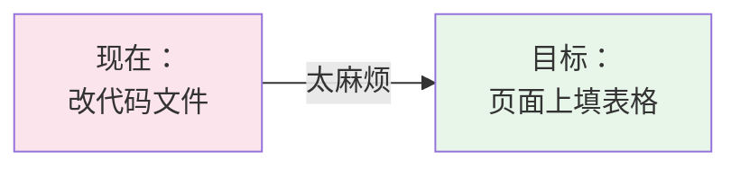

### 2.3 为什么要分前端和后端

这是新手最容易懵的地方。一句话：

> **前端负责"好看和好用"，后端负责"真正干活和保管东西"。**

举个具体例子——你在页面上加一个叫"查订单"的工具：

| 步骤 | 谁干的 | 干什么 |
|---|---|---|
| 1 | **前端** | 显示一个表单，让你填：工具名叫什么、要传什么参数、调用哪个网址 |
| 2 | **前端** | 你点"保存"，它把内容打包，通过"传菜口"递给后端 |
| 3 | **后端** | 检查一下：名字重复了吗？参数合法吗？ |
| 4 | **后端** | 把这份工具定义存进硬盘 |
| 5 | **后端** | 告诉 dsh："模型现在可以用'查订单'这个工具了" |
| 6 | **后端** | 以后模型真的调用"查订单"时，是后端去发网络请求 |
| 7 | **前端** | 把新工具显示在列表里，让你看到 |

**为什么要这么分？** 因为：

1. **安全**——只有后端能碰硬盘和网络，浏览器不能随便碰
2. **省事**——页面刷新时，后端的活不用重干
3. **可替换**——将来想换个界面（比如做成命令行版），后端不用动

### 2.4 一个必须先懂的概念：什么是"插件"

dsh 的设计叫**"一切皆插件"**。听起来玄，其实很简单：

> dsh 本身不是一个写死的程序，而是**一堆小零件拼起来的**。工具、界面、存储、甚至"AI 思考的流程"本身，都是零件。你可以换掉任何一个。

这对你的好处：**你不需要改 dsh 的代码**，只要自己做一个零件，插上去就行。别人升级 dsh，你的零件还在。

---

## 3. 目标与非目标

### 目标

1. 做一个**可移植的插件包**——一条命令装进任何 dsh，一条命令卸干净。
2. 在网页界面里提供一个**设置页**，用鼠标完成：
   - 定义 / 编辑 / 删除自己的工具
   - 组装 AI 助手（选工具、写人设、排顺序）
   - 预览生成的结果
3. 组装出来的助手**马上就能用**（新建对话时可选）。

### 非目标（明确划出去，防止越做越大）

- 不改 dsh 的源代码、不复制它的代码来改
- 不做模型设置（那是 dsh 自带的"设置 → 模型"）
- 不做聊天记录管理、不做主题皮肤、不做桌宠

---

# 第二部分 · 为什么这么做

## 4. 技术选型依据：为什么是 dsh，不是 Codex Harness

两边现在都开源了（dsh 用 MIT 协议，Codex 用 Apache-2.0），差别不在"开不开源"，而在**设计思路**。

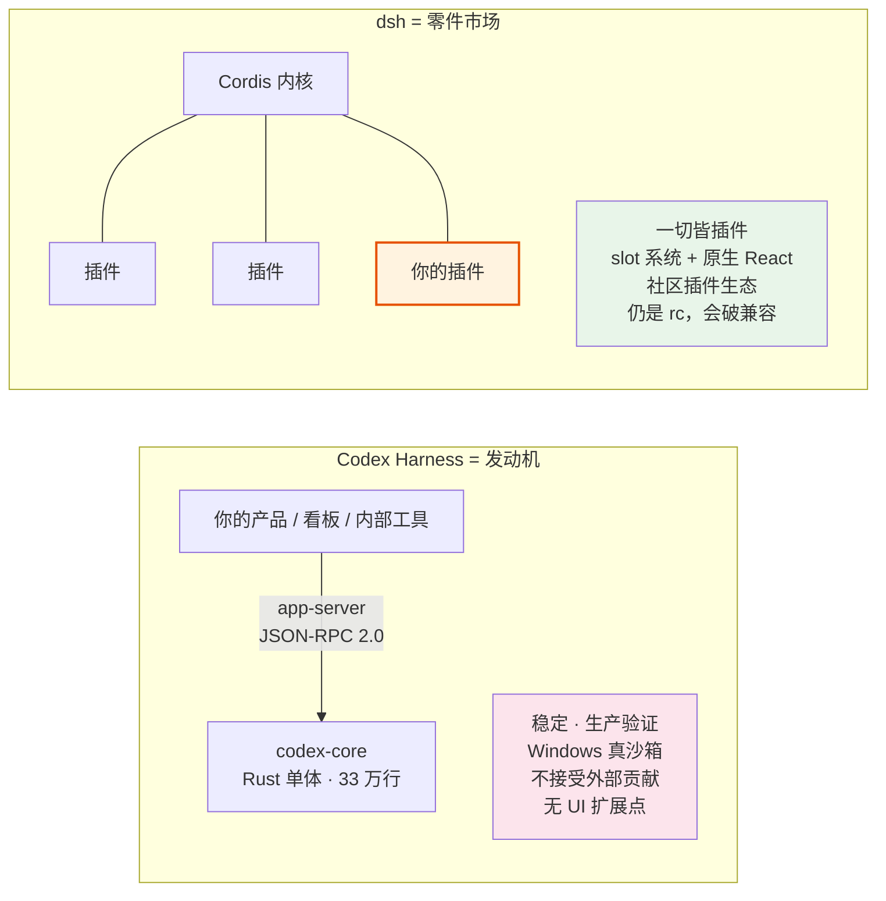

### 对比表

| 维度 | Codex Harness | DeepSeek Harness |
|---|---|---|
| 用什么语言写的 | Rust（编译成单个程序） | TypeScript / Node（一堆 npm 包） |
| 核心是什么 | 一个 33 万行的单体程序 | Cordis（插件容器） |
| 给你复用什么 | **整套 AI 思考流程** | **组装能力** |
| 你能改到什么程度 | 只能在它规定的接口里做 | 什么都能换，连核心流程都能换 |
| 官方收不收你的代码 | **不收**（官方明确声明） | 收，社区插件生态活跃 |
| 稳定度 | v0.149 稳定版，已有客户在用 | 0.1.x-**测试版**，官方说会破坏兼容 |
| 安全隔离 | 三套原生沙箱（含 Windows） | 有沙箱+审批，Windows 上部分功能打折 |
| **有没有网页接口给你挂页面** | **没有** | **有**（slot 系统） |

### 结论

> **Codex 是更好的"成品"，dsh 是更好的"底座"。**
> 我们要在底座上做扩展，所以选 dsh。

最关键的一条：我们这个项目**整个界面**都要靠 dsh 的 slot 系统、现成 React 组件、设置页座位、审批弹窗、前后端管道——**这些 dsh 白送，Codex 一个都没有**。选 Codex 等于要从零造一个网站。

**两者不冲突**：dsh 自带把 Codex 当"助手"调用的官方插件，需要时可以让 Codex 来干重活。

---

# 第三部分 · 这个项目长什么样

## 5. dsh 的两个平面（理解插件运行在哪）

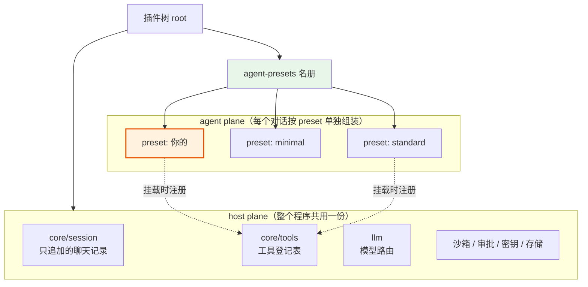

**大白话**：

- **上层（host plane）** = 商场的公共设施，所有店铺共用一份
- **下层（agent plane）** = 每家店铺自己的装修，各是各的

**最关键的规则**：工具是登记在"调用它的那个上下文"里的。挂在 `P3` 的插件注册的工具，**只有 P3 的助手看得见**。

> 🛡️ 这就是 dsh 防止"A 店的工具漏到 B 店"的机制。

⚠️ **一条硬规矩**：同一个层里，工具**重名会直接报错**；不同层里重名则是"近的盖住远的"。

## 6. 配置怎么叠（你的包插在哪）

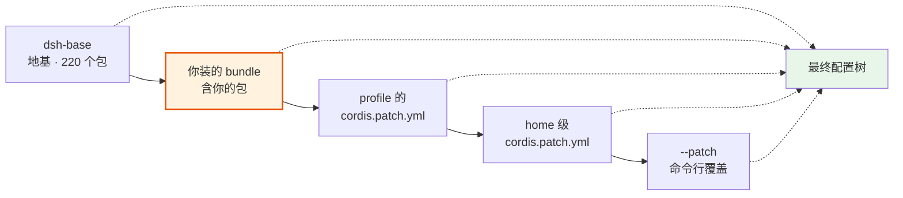

**大白话**：dsh 启动时，从左边开始一层层"贴"配置，**右边的盖住左边的**。

你的插件在 `B` 这一层。这意味着：

- 你不用改 dsh 的代码，只要"贡献一层"
- 别人也能在他们的层里盖住你的设置（这是设计，不是 bug）
- 卸载时（`remove`），`B` 从列表里消失，一切恢复原样

---

## 7. 项目结构分层总图 ★

这是整个项目的骨架。**记住这张图，就知道每样东西该放哪。**

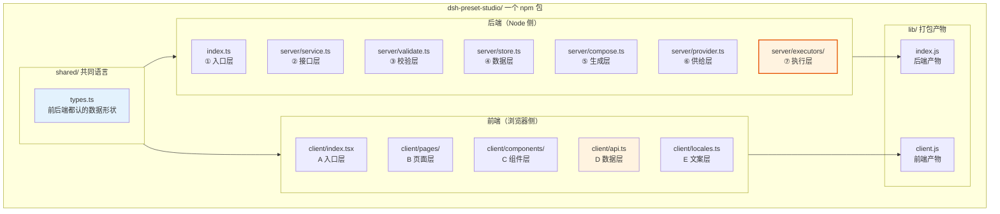

### 对应的实际目录

```text
dsh-preset-studio/
│
├── package.json              ← 说明书：这个包叫什么、导出什么
├── cordis.patch.yml          ← 挂载声明：告诉 dsh "把我加上"
├── tsdown.config.ts          ← 打包配置：前端后端各打一个文件
├── tsconfig.json             ← TypeScript 配置
│
├── src/
│   │
│   ├── shared/               ← 【共同语言】前后端都要用的东西
│   │   └── types.ts          ←   数据结构定义（ToolDef / AgentDef）
│   │
│   ├── index.ts              ← 【后端-入口层】dsh 从这里加载插件
│   │
│   ├── server/               ← 【后端】所有"后厨"代码
│   │   ├── service.ts        ←   接口层：定义前端能调哪些方法
│   │   ├── validate.ts       ←   校验层：检查数据合不合法
│   │   ├── store.ts          ←   数据层：存和取
│   │   ├── compose.ts        ←   生成层：把配置写成 YAML 文件
│   │   ├── provider.ts       ←   供给层：把工具交给模型 ★
│   │   └── executors/        ←   执行层：真的去发请求 / 跑命令
│   │       ├── index.ts      ←     分发：按类型选执行器
│   │       ├── http.ts       ←     发 HTTP 请求
│   │       ├── shell.ts      ←     跑系统命令
│   │       └── mcp.ts        ←     转给 MCP 服务
│   │
│   └── client/               ← 【前端】所有"柜台"代码
│       ├── index.tsx         ←   入口层：把页面挂到 dsh 的设置里
│       ├── pages/            ←   页面层：一整页
│       │   ├── ToolsPage.tsx ←     工具管理页
│       │   └── AgentsPage.tsx←     助手组装页
│       ├── components/       ←   组件层：可复用的小零件
│       │   ├── ToolList.tsx
│       │   ├── ToolForm.tsx
│       │   ├── ParamTable.tsx
│       │   ├── ExecutorForm.tsx
│       │   ├── AgentForm.tsx
│       │   └── YamlPreview.tsx
│       ├── api.ts            ←   数据层：调后端的唯一出口
│       └── locales.ts        ←   文案层：中英文
│
└── lib/                      ← 【产物】打包生成的，不手改
    ├── index.js
    └── client.js
```

> 🔑 **记住一句话**：`src/server/` 是后厨，`src/client/` 是柜台，`src/shared/` 是两边都要用的东西。

## 8. 一个包，两半，五块

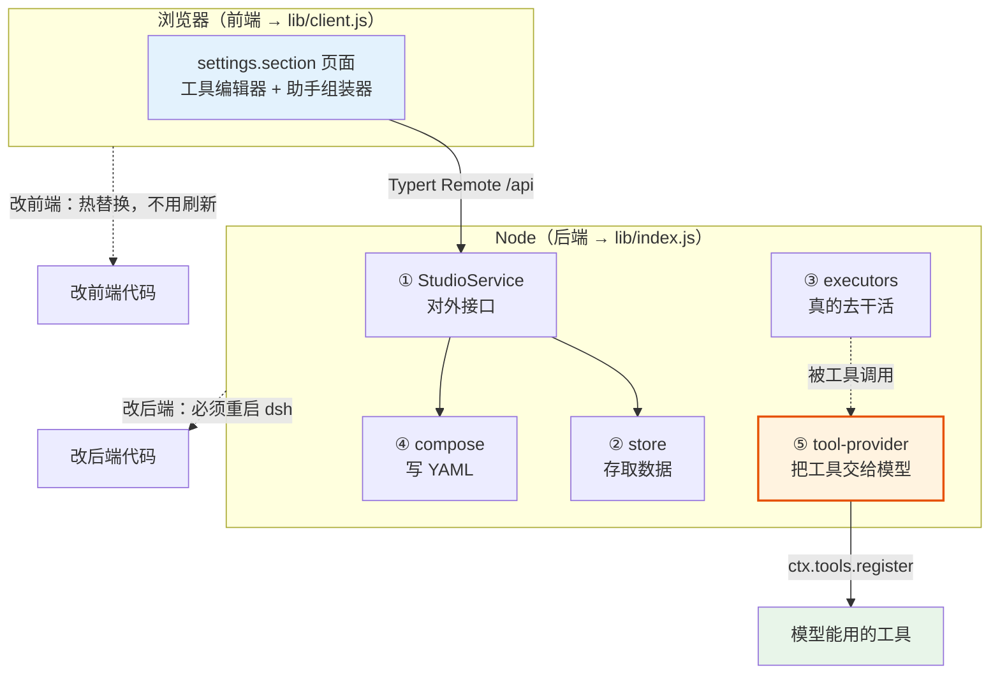

| 块 | 干什么 | 在哪 | 大白话 |
|---|---|---|---|
| ① StudioService | 对外接口，校验 + 落盘 | `server/service.ts` | 点菜系统 |
| ② store | 存工具和助手定义 | `server/store.ts` | 仓库 |
| ③ executors | 按配置真的执行 | `server/executors/` | 厨师 |
| ④ compose | 把定义渲染成 YAML | `server/compose.ts` | 摆盘 |
| ⑤ **tool-provider** | 读配置 → 注册工具 | `server/provider.ts` | **上菜** ★ |
| UI | 设置页 | `client/` | 柜台 |

> **⑤ 是整个设计的关键**：它不是界面，是一个**独立出口**，由生成的 preset 用一行挂载。它把"页面上配的工具"变成"模型手里的一双手"。

---

# 第四部分 · 前端怎么实现

## 9. 前端技术栈

### 用什么

| 技术 | 是什么 | 为什么用它 |
|---|---|---|
| **React** | 做网页界面的工具 | dsh 的界面本来就是 React，slot 系统直接给你插组件 |
| **TypeScript** | 带类型检查的 JavaScript | 写错字会当场报错，不用等运行才发现 |
| **tsdown** | 打包工具 | 把源码打包成 dsh 能读的文件 |
| **dsh 原生组件** | `ui-primitives` | 按钮、输入框、图标、Markdown 渲染——**白送，不用自己写** |

### 打包后的样子

前端代码打包成**一个文件** `lib/client.js`，格式是 **CommonJS**（不是普通 ES 模块）。

> ⚠️ 这是 dsh 的硬要求：浏览器那边的加载器**只认 CommonJS**，而且文件开头必须是特定格式的工厂函数。所以**不要手改 `lib/client.js`**，永远改 `src/client/` 里的源码。

### 一个新手最容易踩的坑

`package.json` 里有**两个叫 `inject` 的东西**，名字一样，意思完全不同：

| 位置 | 叫什么 | 是什么 | 例子 |
|---|---|---|---|
| `package.json` 里 | `dsh.client.inject` | **包名清单**（管加载顺序） | `"@deepseek-ai/dsh-client-ui-slots"` |
| 源码里 | `export const inject` | **服务名清单**（管能用什么能力） | `['slots']` |

**搞混的后果**：插件加载了但页面不出现。记住：一个是"包名"，一个是"能力名"。

## 10. 前端怎么分层解耦

### 分层图

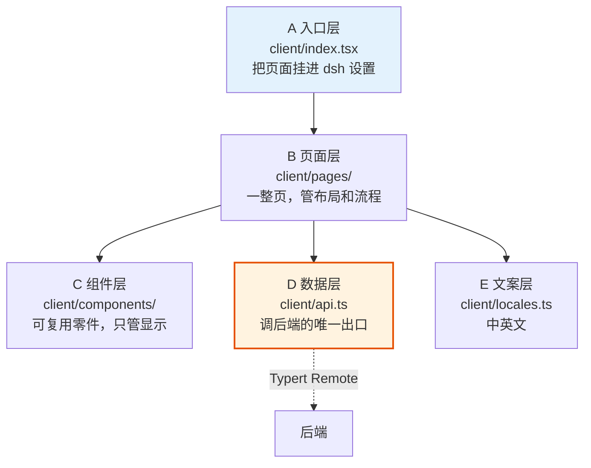

### 每层干什么

| 层 | 干什么 | 不干什么 | 大白话 |
|---|---|---|---|
| **A 入口层** | 注册页面到 dsh | 不写任何界面 | 店门口的招牌 |
| **B 页面层** | 组织一整页的布局和数据流 | 不直接写网络请求 | 一个房间 |
| **C 组件层** | 显示，收到数据就画 | **不碰后端、不碰全局状态** | 家具 |
| **D 数据层** | 所有跟后端的对话都走这 | 不处理界面 | 传菜口 |
| **E 文案层** | 中英文对照 | 不写逻辑 | 菜单翻译 |

### 三条解耦铁律

**铁律 1：组件不碰 `ctx`**

`ctx` 是 dsh 的全局对象，能拿到一切能力。但**页面组件拿不到它**——这是 dsh 故意的。

```tsx
// ❌ 错误：组件里想用 ctx
function ToolList() {
  const tools = ctx.remote.presetStudio.list()  // 拿不到 ctx！
}

// ✅ 正确：数据从 props 传进来
function ToolList({ tools, onDelete }: Props) {
  return tools.map(t => <Row key={t.id} onDelete={onDelete} />)
}
```

**大白话**：家具不该自己去厨房拿菜，应该由房间把菜递过来。

**铁律 2：只有 `api.ts` 跟后端说话**

```tsx
// ❌ 错误：页面里直接写网络请求
function ToolsPage() {
  const save = async (def) => {
    await ctx.remote.presetStudio.saveTool(def)   // 又碰 ctx 了
  }
}

// ✅ 正确：统一走 api.ts
// client/api.ts
export const api = {
  listTools:  () => ctx.remote.presetStudio.listTools(),
  saveTool:   (def) => ctx.remote.presetStudio.saveTool(def),
  deleteTool: (id)  => ctx.remote.presetStudio.deleteTool(id),
}

// client/pages/ToolsPage.tsx
import { api } from '../api'
const save = async (def) => { await api.saveTool(def) }
```

**好处**：将来后端改名了，只改 `api.ts` 一个文件。

**铁律 3：不 import 别的插件**

> 跨插件的值 import 是**构建错误**，不是风格建议。

**为什么**：打包另一个插件的代码会造成"同一个东西有两份"，运行时直接崩。要协作只能通过 dsh 的 **service** 和 **slot**。

### 自己的实现放哪

| 你要做的事 | 放哪 |
|---|---|
| 加一个新页面 | `src/client/pages/XxxPage.tsx` |
| 加一个新组件 | `src/client/components/Xxx.tsx` |
| 加一个新接口调用 | `src/client/api.ts` |
| 加一段新文案 | `src/client/locales.ts` |
| 改页面的挂载位置 | `src/client/index.tsx` |

## 11. 前端目录：每层放哪

```text
src/client/
├── index.tsx              ← 【挂载】注册 settings.section，就几行
│
├── pages/                 ← 【页面】一整页，负责"布局 + 串流程"
│   ├── ToolsPage.tsx      ←   工具页：左边列表 + 右边表单
│   └── AgentsPage.tsx     ←   助手页：左边列表 + 右边组装器
│
├── components/            ← 【零件】只负责显示，不碰后端
│   ├── ToolList.tsx       ←   工具列表
│   ├── ToolForm.tsx       ←   工具表单
│   ├── ParamTable.tsx     ←   参数表格（可增删行）
│   ├── ExecutorForm.tsx   ←   执行器表单（按类型显示不同字段）
│   ├── AgentForm.tsx      ←   助手组装表单
│   └── YamlPreview.tsx    ←   生成结果预览
│
├── api.ts                 ← 【数据】调后端的唯一出口
└── locales.ts             ← 【文案】中英文
```

### 挂载代码长什么样

```tsx
// src/client/index.tsx —— 整个前端只有这里碰 ctx
import type { ClientContext } from '@deepseek-ai/dsh-client-runtime/client'
import { createApi } from './api'
import { StudioPage } from './pages/StudioPage'

export const inject = ['slots']          // ← 服务名，不是包名

export function apply(ctx: ClientContext) {
  // api 活在这个闭包里（它握有 ctx）。
  // 组件不碰 ctx —— 只通过 inject face 拿到 api。
  const api = createApi(ctx)

  ctx.slots.inject('settings.section', () =>
    ctx.slots.register(
      {
        name: 'settings.section',
        id: 'preset-studio',
        order: 100,
        inject: () => ({ api }),        // ← 把 api 交给组件
      },
      StudioPage,
    ),
  )
}
```

**大白话**：这几行的意思是——"在 dsh 的设置里，给我一个叫 preset-studio 的位置，用来放我的页面；顺便把这个 `api` 递给页面用"。

> 用 `ctx.slots.inject(...)` 而不是直接 `register`：前者绑定了生命周期，插件卸载时自动清理。

> 💡 **为什么是 `StudioPage` 而不是 `ToolsPage`**：一个 `settings.section` 只能放一个组件。我们要两页（工具 / 助手），所以先放一个"壳"，由壳内部切标签。

> 📄 **上面每个文件的完整代码见 [§29 前端完整代码](#29-前端完整代码react)。**

## 12. 页面信息架构

一个设置页，两个标签：

### 工具页

| 区域 | 内容 |
|---|---|
| 左边：列表 | 名称 / 执行器类型 / 启用开关 |
| 右边：编辑器 | 基本信息（名字 / 说明 / 开关）<br/>参数表格（增删行：参数名 / 类型 / 是否必填 / 说明 / 可选值）<br/>执行器（下拉选 http / shell / mcp → 显示对应字段）<br/>输出（结果类型 + 显示方式）<br/>实时校验提示（重名 / 名字不合法 / 用了不支持的嵌套） |

### 助手页

| 区域 | 内容 |
|---|---|
| 左边：列表 | 你的助手 |
| 右边：组装器 | 基本信息（id / 名字 / 说明 / 排序）<br/>人设文本框<br/>官方工具勾选组<br/>自定义工具勾选组<br/>生成结果预览 |

> ⚠️ **不要照着截图猜 slot 名字**。以目标版本 dsh 里的 `slot-catalog.ts` 为准——名字对不上就挂不上去。

---

# 第五部分 · 后端怎么实现

## 13. 后端技术栈

### 用什么

| 技术 | 是什么 | 为什么 |
|---|---|---|
| **Node.js** | 跑 JavaScript 的环境 | dsh 就跑在它上面 |
| **TypeScript** | 带类型的 JavaScript | 同上 |
| **Cordis** | dsh 的插件容器 | 它管插件的加载、依赖、卸载 |
| **dsh 原生服务** | `ctx.tools` / `ctx.agentPresets` / `ctx.shell` / `ctx.storageDomain` | **白送，不用自己写** |

### 一个后端插件的骨架

后端插件就是**一个导出 `apply` 函数的文件**：

```ts
import type { Context } from '@deepseek-ai/cordis'

export const name = 'my-plugin'        // 插件名
export const inject = ['tools']        // 我需要 tools 这个能力

export function apply(ctx: Context) {
  // 在这里注册能力
}
```

**大白话**：dsh 加载插件时会喊一声 `apply`，把 `ctx`（一个"万能遥控器"）递给你。你说"我要用 tools"，它就等你拿到 tools 才开始。

### 自动清理（这点很重要）

通过 `ctx` 注册的一切，**插件卸载时自动撤销**。你不用写 `cleanup()`。

```ts
ctx.tools.register(myTool)              // 卸载时自动注销
ctx.on('some-event', handler)           // 卸载时自动移除
ctx.effect(() => {                      // 需要手动清理的（定时器、连接）
  const timer = setInterval(...)
  return () => clearInterval(timer)     // 返回的函数在卸载时执行
})
```

**为什么重要**：这是"可移植、可卸载、不残留"的根本保证。

## 14. 后端怎么分层解耦

### 分层图

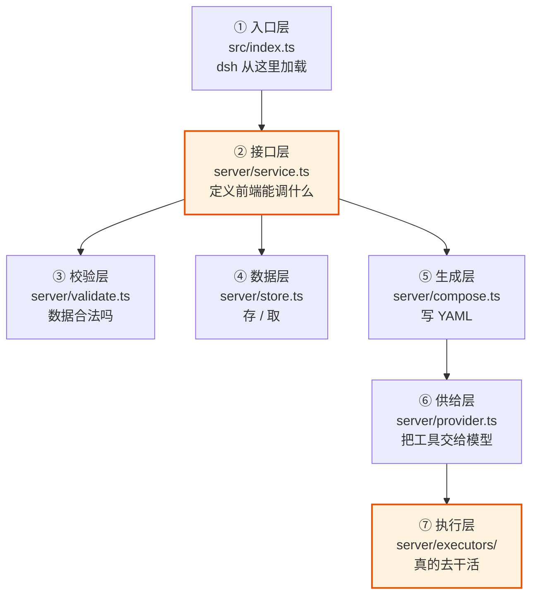

### 每层干什么

| 层 | 干什么 | 不干什么 | 大白话 |
|---|---|---|---|
| **① 入口层** | dsh 加载插件的门 | 不写业务逻辑 | 后厨大门 |
| **② 接口层** | 定义前端能调的方法 | 不写具体实现 | 点菜系统 |
| **③ 校验层** | 检查数据合不合法 | 不存不改 | 质检员 |
| **④ 数据层** | 存和取 | 不管怎么执行 | 仓库 |
| **⑤ 生成层** | 把配置渲染成 YAML | 不决定用哪些工具 | 摆盘 |
| **⑥ 供给层** | 注册工具给模型 | 不关心前端 | 上菜 |
| **⑦ 执行层** | 真的发请求 / 跑命令 | 不认识前端 | 厨师 |

### 三条解耦铁律

**铁律 1：只用 `ctx` 拿能力，不 import 框架内部**

```ts
// ❌ 错误：直接 import dsh 的内部文件
import { something } from '@deepseek-ai/dsh-tools/lib/internal/xxx'

// ✅ 正确：通过 ctx 拿
export const inject = ['tools']
export function apply(ctx: Context) {
  ctx.tools.register(...)   // 通过 ctx
}
```

**为什么**：dsh 是测试版，内部文件会变。`ctx` 上的接口才是稳定的。

**铁律 2：所有可调参数写进配置，不硬编码**

```ts
import Schema from '@deepseek-ai/schemastery'

export interface Config {
  storageDir?: string     // 存哪
  maxTools?: number       // 最多几个工具
}

export const Config: Schema<Config> = Schema.object({
  storageDir: Schema.string().default(''),   // 默认值写在这里
  maxTools:   Schema.number().default(50),
})

export function apply(ctx: Context, config: Config) {
  // config 已经是完整的了，dsh 会填好默认值
}
```

**为什么**：别人装你的插件时，不改代码就能调整行为。这也是"可移植"的前提。

**铁律 3：依赖单向流动**

```text
入口 → 接口 → { 校验, 数据, 生成 } → 供给 → 执行
```

**不许反向依赖**。具体说：

- 执行层**不知道**前端存在
- 数据层**不调用**执行层
- 校验层**不写**数据

**为什么**：将来想换个界面（比如做成命令行），或者单独测试执行层，都不用动其他层。

### 自己的实现放哪

| 你要做的事 | 放哪 |
|---|---|
| 加一个新接口 | `src/server/service.ts` |
| 加一条校验规则 | `src/server/validate.ts` |
| 改存储方式 | `src/server/store.ts` |
| 改生成的文件格式 | `src/server/compose.ts` |
| 加一种新的工具类型 | `src/server/executors/` 里加一个文件 |
| 改工具怎么交给模型 | `src/server/provider.ts` |

> 注意：**这些"要自己写"的部分，比前端少得多**。因为 dsh 已经给了工具注册、校验、审批、存储、传输。真正自己写的只有**执行器**（第 ⑦ 层）。

## 15. 后端目录：每层放哪

```text
src/
├── index.ts               ← 【入口】就几行：声明 inject、导出 apply
│
├── shared/                ← 【共同语言】前后端都 import 这里
│   └── types.ts           ←   ToolDef / AgentDef 的类型定义
│
└── server/                ← 【后端】所有后厨代码
    ├── service.ts         ←   接口层：Service 类 + 方法定义
    ├── validate.ts        ←   校验层：纯函数，输入定义输出错误列表
    ├── store.ts           ←   数据层：读写持久化
    ├── compose.ts         ←   生成层：定义 → YAML 字符串
    ├── provider.ts        ←   供给层：被 preset 挂载，注册工具 ★
    └── executors/
        ├── index.ts       ←     分发器：按 kind 选
        ├── http.ts        ←     发 HTTP
        ├── shell.ts       ←     跑命令（必须走审批）
        └── mcp.ts         ←     转 MCP
```

### 入口代码长什么样

```ts
// src/index.ts —— 后端只有这里是"插件入口"
import Schema from '@deepseek-ai/schemastery'
import type { Context } from '@deepseek-ai/cordis'
import { StudioService } from './server/service'

export const name = 'preset-studio'
export const inject = ['tools', 'agentPresets', 'storageDomain']

export interface Config {
  storageDir?: string
  maxTools?: number
}
export const Config: Schema<Config> = Schema.object({
  storageDir: Schema.string().default(''),
  maxTools: Schema.number().default(50),
})

export function apply(ctx: Context, config: Config) {
  // 挂上服务，前端就能通过 ctx.remote.presetStudio 调它
  ctx.plugin(StudioService, config)
}
```

## 16. 后端接口怎么分 ★

### 命名规律

**一句话记住**：`命名空间.资源.动作()`

```text
ctx.remote.presetStudio.tools.list()
     └─ 谁提供的 ─┘ └─ 资源 ─┘└动作┘
```

**大白话**：就像餐厅点菜——先说是哪家店（`presetStudio`），再说是哪个大类（`tools`），最后说要干什么（`list`）。

### 完整接口清单

```text
presetStudio/                       ← 总命名空间（前端通过 ctx.remote.presetStudio 调）
│
├── tools.                          ← 【工具】资源
│   ├── list      ( )          → ToolRow[]         列出所有工具
│   ├── get       (id)         → ToolDef           拿一个工具的完整定义
│   ├── save      (def)        → { id }            新建或保存
│   ├── delete    (id)         → void              删除
│   └── validate  (def)        → { ok, errors[] }  只校验不保存
│
├── agents.                         ← 【助手】资源
│   ├── list      ( )          → AgentRow[]        列出所有助手
│   ├── get       (id)         → AgentDef          拿一个助手的完整定义
│   ├── save      (def)        → { id }            新建或保存
│   ├── delete    (id)         → void              删除
│   └── validate  (def)        → { ok, errors[] }  只校验不保存
│
├── compose.                        ← 【生成】资源
│   ├── preview   (id)         → { yaml }          预览会生成什么（不写盘）
│   └── apply     (id)         → void              真正写入磁盘
│
└── meta.                           ← 【元信息】资源
    ├── builtinTools ( )       → BuiltinRef[]      官方有哪些工具可以勾选
    ├── executors    ( )       → ExecutorKind[]    支持哪些执行器类型
    └── stat         ( )       → { counts }        统计（几个工具、几个助手）
```

### 为什么要按"资源"分，而不是按"页面"分

| 分法 | 例子 | 问题 |
|---|---|---|
| ❌ 按页面分 | `toolsPageLoad()` / `agentsPageSave()` | 页面改造了接口就废了 |
| ✅ 按资源分 | `tools.list()` / `agents.save()` | 页面随便改，接口不动 |

**大白话**：菜单按"菜系"分，不按"哪张桌子点的"分。

### 两个设计约定

**约定 1：`validate` 单独一个接口**

因为**前端要边填边提示**，不能等点保存才知道错了。

```text
用户正在填 → 每次改动调一次 validate → 实时显示红字
用户点保存 → 再调一次 validate → 通过才 save
```

**约定 2：`preview` 和 `apply` 分开**

因为用户可能只想看看生成了什么，不想真的写盘。

### 出错怎么表示

统一用一个 `RemoteError`，带一个错误码：

```ts
throw new RemoteError('tools/duplicate-name', '工具名重复了', { name: 'query_orders' })
//                         └─ 域/原因 ──┘  └─ 给人看 ─┘   └─ 额外信息 ─┘
```

**错误码格式**：`<域>/<原因>`，比如：

| 错误码 | 意思 |
|---|---|
| `tools/duplicate-name` | 工具名重复 |
| `tools/invalid-name` | 工具名格式不对 |
| `agents/invalid-id` | 助手 id 不合法 |
| `agents/not-found` | 找不到这个助手 |

> ❌ **不要**给每种错误建一个类，dsh 的设计就是"一个错误类 + 一张错误码表"。

---

## 17. 数据模型

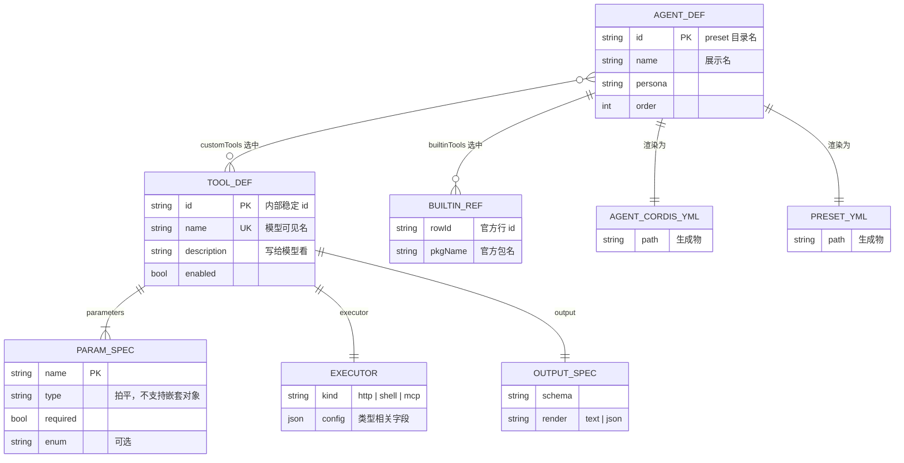

**大白话**：这张图说的是"谁包含谁"。

- 一个**工具**包含：若干**参数** + 一个**执行器** + 一个**输出定义**
- 一个**助手**包含：若干选中的**自定义工具** + 若干选中的**官方工具**
- 一个**助手**会生成两个文件：`agent.cordis.yml` 和 `preset.yml`

### 字段约束（都是硬要求）

| 字段 | 约束 | 为什么 |
|---|---|---|
| 工具的 `name` | 唯一，只能用 `[a-z0-9_]` | 同一个层里重名会直接报错 |
| 工具的 `parameters` | **拍平的列表，不支持对象里套对象** | dsh 的 schema 语法限制 |
| 助手的 `id` | `[a-z0-9][a-z0-9-]*` | 它会变成文件夹名字 |
| 所有返回值 | **不能有 `undefined`** | dsh 会检查，发现就拒 |
| schema 字面量 | 要写 `as const` | 否则类型会被"放宽"，检查失效 |

⚠️ 这几条**前端就要拦住**，不要等后端报错——用户体验差，而且错误信息难懂。

### 三种执行器

| 类型 | 页面上要填 | 安全等级 |
|---|---|---|
| `http` | 请求方法 / 网址 / 请求头 / 参数 / 请求体模板 / 从响应里取哪一段 / 超时 | 中（可做白名单） |
| `shell` | 命令模板 / 工作目录 / 环境变量 / 怎么解析输出 | **高——必须走审批** |
| `mcp` | 服务标识 / 勾选哪些工具 | 低 |

### 两条安全红线

**红线 1：参数占位符绝对不做字符串拼接**

```ts
// ❌ 危险：用户传 `; rm -rf /` 就完了
const cmd = `deploy.sh ${args.env}`

// ✅ 安全：用数组传参，操作系统不会当成命令解析
const cmd = ['deploy.sh', args.env]   // shell: false
```

**大白话**：拼字符串就像把用户说的话直接念给操作系统听；用数组就像把它当成"一个完整的词"递过去。

**红线 2：shell 执行器必须走 dsh 的审批**

在 `tools/pre-execute` 上返回"要问用户"：

```ts
ctx.on('tools/pre-execute', async (exec, next) => {
  if (exec.name === 'deploy_prod') {
    return { kind: 'ask', reason: `将要执行: ${exec.arguments.cmd}` }
  }
  return next()
})
```

**好处**：dsh 会自动弹出原生确认框——**你不用自己画界面**。

> ⚠️ 注意：如果 dsh 没装审批服务，`ask` 会**自动变成拒绝**。这是官方的安全默认，不要绕过。

## 18. 生成的 preset 文件

### `agent.cordis.yml`（助手本体）

```yaml
# 你的工具提供者：一行挂载，配置内联 → 助手自包含、能整个搬走
- id: studio-tool-provider
  name: 'dsh-preset-studio/tool-provider'
  config:
    tools:
      - name: query_orders
        description: 查询订单
        parameters: [...]
        executor: { kind: http, ... }
      - name: deploy_prod
        description: 部署
        parameters: [...]
        executor: { kind: shell, ... }

# 人设
- id: studio-persona
  name: 'dsh-preset-studio/persona'
  config:
    text: |
      你是一个……

# 勾选的官方工具（行 id / 包名以实机为准）
- id: <official-tool-row-id>
  name: '<官方包名>'
```

### `preset.yml`（只有展示文本）

```yaml
name: 我的助手
description: 页面生成
```

> ⚠️ **官方工具的名字不要猜。** 第 23 章的"模块 1"就是要把它查清楚——从 `--dump-config` 的输出和官方 `minimal` preset 的实际内容里读出来。
>
> ⚠️ **一条硬规矩**：preset 里凡是**提供服务的行**，必须放在带 `isolate` 的分组里，否则两个 preset 提供同名服务会打架。

## 19. 一次「保存」的完整数据流

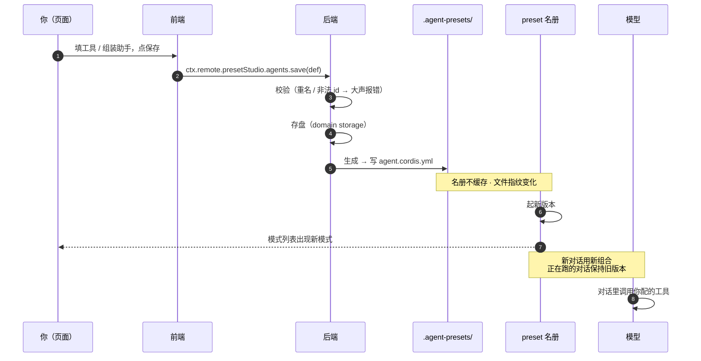

**两个必须理解的语义**：

1. **名册不缓存**——每次列都重读硬盘，写进去马上能看见，**不用重启**。
2. **切换只在"空对话"时生效**——已经聊过的对话不能换配置。页面改的是"**新对话用什么**"，不是"当前对话变成什么"。

---

# 第六部分 · 机制细节

## 20. 工具执行流水线（全原生，你只需声明）

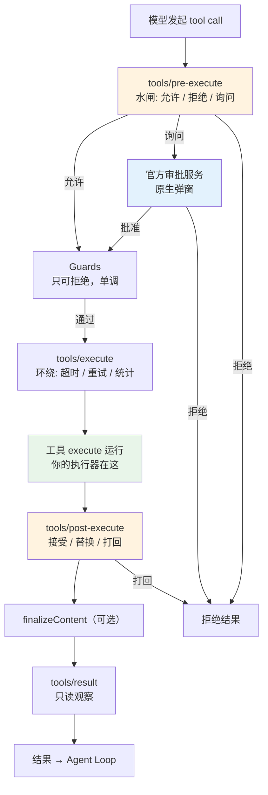

**大白话**：模型说"我要用某个工具"之后，dsh 会**过五道关卡**才真的执行。

**对我们意味着什么**：

| 关卡 | 我们要做什么 |
|---|---|
| `pre-execute` | **shell 执行器必须在这里说"要问用户"**。dsh 会自动弹窗 |
| Guards | 不用管，那是别人的安全红线 |
| `execute` | **这里放我们的执行器**——唯一的真活儿 |
| `post-execute` | 可选：输出太长时截断 |
| `result` | 不用管 |

**dsh 白送的**：参数校验、输出校验、超时、并发控制、审批弹窗、界面渲染。**这些我们都不写。**

## 21. Agent Loop 与三个接管点

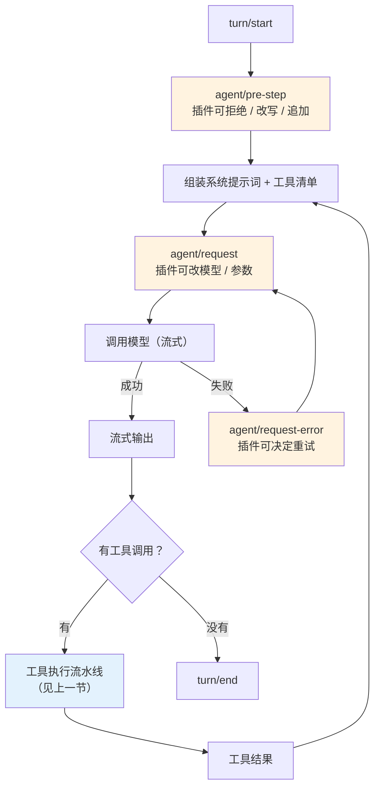

**要点**：三个橙色点是 **"接管点"**——插件在这里**接管决策**（可以拒绝、改写、重试），不是旁路偷听。

本项目**暂时不用**它们。但知道它们在哪，将来想做"工具调用限流""模型自动降级"时有位置可挂。

**状态的真相**：对话的一切状态都是**只追加的聊天记录**推导出来的。"回放"是一等公民——断线重连、恢复、审计都不是"重跑一遍"，而是"重放记录"。

## 22. Remote API 契约（前后端约定）

| 方法 | 签名 | 说明 |
|---|---|---|
| `validate` | `(def) → { ok, errors[] }` | 只校验不保存 |
| `listTools` | `() → ToolRow[]` | |
| `saveTool` | `(def) → { id }` | |
| `deleteTool` | `(id) → void` | |
| `listAgents` | `() → AgentRow[]` | |
| `saveAgent` | `(def) → { id }` | |
| `deleteAgent` | `(id) → void` | |
| `composePreview` | `(id) → { yaml }` | 不写盘，只看 |
| `revealPresetDir` | `(id) → { opened, path }` | 可选 |

**契约怎么生成**：跑 `pnpm typert:gen` 生成 `lib/typert.*`，**要提交进 git**。改了方法签名必须重跑。

**大白话**：这个东西像"前后端之间的合同模板"——dsh 根据后端的方法定义，自动生成一份前端能用的、带类型检查的调用代码。你不用手写。

> ⚠️ **一个会吃掉半天的坑（见第 26 章 R4）**：`@Remote` 装饰器有个模块私有的登记表，本地 link 安装时会失灵，导致接口全部 404。要用 `ctx.typert.register(...)` 显式注册。

---

# 第七部分 · 动手做

## 23. 开发顺序：第一个模块做什么，以此类推 ★

**这一章是给"准备动手"的人看的。** 按顺序做，每个模块都有明确的"做完能看到什么"。

> 原则：**每一步都要能看到东西**。看不到就先别往下走——否则出问题时你分不清是哪一步坏的。

### 模块 1 · 包骨架（能让 dsh 认识你）

**做什么**
- 建目录、写 `package.json`（声明导出什么、打包什么）
- 写 `cordis.patch.yml`（告诉 dsh "把我加上"）
- 写一个空的 `apply` 函数，里面只打一行日志
- **顺便侦察**：跑 `dsh --profile web --dump-config`，看清楚 dsh 自带的工具叫什么名字、官方 preset 长什么样

**做完能看到**
```bash
dsh --profile web --dump-config   # 输出里有你的插件名
```
启动时终端打印你的日志。

**为什么第一步做这个**：这是唯一能验证"加载链路通了"的方法。先让 `apply` 被执行，再往里加功能。

---

### 模块 2 · 前端入口 + 空页面（能看到一个页面）

**做什么**
- 写 `src/client/index.tsx`，注册一个 `settings.section`
- 页面先只显示一行字："Hello from Preset Studio"
- 配好 `tsdown.config.ts`（前后端各打一个文件）

**做完能看到**：dsh 设置里出现"Preset Studio"，点进去有个空页面。

**为什么第二步做这个**：界面能出来，说明前端打包链路也通了。而且这一步**改代码不用重启**（前端有热替换）——开发体验最好，适合先跑通。

---

### 模块 3 · 共享类型（前后端约定"数据长什么样"）

**做什么**
- 写 `src/shared/types.ts`，定义 `ToolDef` / `AgentDef` / `ParamSpec` 等
- 前后端都 import 这个文件

**做完能看到**：编译通过，前后端用同一套类型。

**为什么必须先做**：这是前后端的"共同语言"。先定好，后面两边都照着写，不会对不上。

---

### 模块 4 · 后端接口骨架（前端能拿到数据）

**做什么**
- 写 `StudioService` 类
- 先只实现一个 `tools.list()`，返回空数组
- 前端调它，把结果打在页面上

**做完能看到**：页面上显示"当前有 0 个工具"。

> ⚠️ 这一层要用 `ctx.typert.register(...)` 显式注册，不要只靠 `@Remote` 装饰器（见 R4）。

**为什么这时候做**：前后端通道打通了，后面就是填空。

---

### 模块 5 · 数据层（数据能存下来）

**做什么**
- 写 `src/server/store.ts`
- 把工具定义存进 dsh 的存储（`ctx.storageDomain`）
- 实现 `saveTool` / `deleteTool`

**做完能看到**：用代码或在页面上加一个工具，**重启 dsh，它还在**。

**为什么先做存储**：没有持久化，后面每次重启都要重配，开发会很痛苦。

---

### 模块 6 · 前端工具页（能增删改了）

**做什么**
- `ToolsPage.tsx`：左边列表 + 右边表单
- `ToolForm.tsx`：名字、说明、开关
- `ParamTable.tsx`：参数表格，能增删行
- `ExecutorForm.tsx`：按类型显示不同字段
- `api.ts`：统一走后端的出口
- 调 `validate` 做实时提示

**做完能看到**：页面上能加工具、改工具、删工具，列表实时更新。

**为什么这时候做**：前端页面是"操作入口"，先能操作，后面才有东西可测。

---

### 模块 7 · 执行层（工具能真的干活）

**做什么**
- `executors/index.ts`：按 `kind` 分发
- `executors/http.ts`：发请求、从响应里取值、处理错误码
- `executors/shell.ts`：跑命令（**用数组传参，接审批**）

**做完能看到**：单元测试里能跑通一次真实的 HTTP 调用。

**为什么先做执行器，再做供给**：先确保"能干活"，再确保"模型能叫得动它"。反过来做的话，出错时你分不清是供给坏了还是执行坏了。

---

### 模块 8 · 生成层 + 供给层 ★ 分水岭

**做什么**
- `compose.ts`：把助手定义渲染成 `agent.cordis.yml`，写到 `.agent-presets/<id>/`
- `provider.ts`：一个独立出口，读配置 → `ctx.tools.register`

**做完能看到**：**新建一个对话，模型能调用你配的工具。**

**为什么这是分水岭**：在这之前，"工具"只是数据库里的一条记录；在这之后，它才是真的能力。

> ⚠️ 这一步的顺序不能提前。它依赖前面所有模块都对。

---

### 模块 9 · 助手组装页（能组装完整人设）

**做什么**
- `AgentsPage.tsx`：勾选工具 + 写人设 + 排顺序
- `YamlPreview.tsx`：预览会生成什么
- 后端补 `agents.*` 和 `compose.preview`

**做完能看到**：页面上组装出的助手能跑，行为符合你的人设和工具集。

---

### 模块 10 · 打包发布

**做什么**
- `pnpm pack` 出 tarball
- 检查产物里有没有 `lib/index.js` 和 `lib/client.js`
- 装到另一个环境验证

**做完能看到**：另一台机器上一条命令装完就能用。

### 模块顺序一览

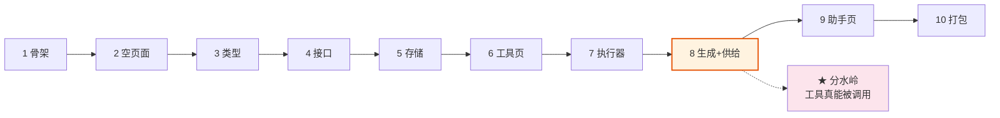

## 24. 分阶段实施（更粗的视角）

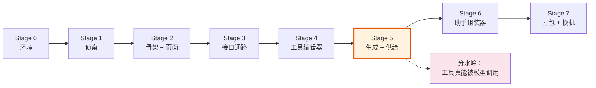

| Stage | 交付 | 验收 | 依赖 |
|---|---|---|---|
| **0** | 确认 Node ≥ 22.19、pnpm 可用 | `npx @deepseek-ai/dsh web` 起得来 | — |
| **1** | 侦察：`--dump-config`、读官方 `minimal` preset 真实内容 | 拿到官方工具的确切行 id 与包名 | 0 |
| **2** | 抄 `dsh-greeting` 骨架，改包名；空页面能渲染 | 设置里出现导航条目并渲染 | 1 |
| **3** | 接口通路走通 | 页面读到真实数据 | 2 |
| **4** | 工具编辑器 CRUD + 持久化 | 页面增删改，重启后还在 | 3 |
| **5** | 生成 + 供给：写 preset，工具真的可调 | **新对话里模型能调到你的工具** | 4 |
| **6** | 助手组装器 + 预览 | 页面上组装出的助手可跑 | 5 |
| **7** | 打包 + 换机验证 | 另一台机器装完能用 | 6 |

**顺序不能跳**：Stage 1 的侦察结果直接决定 Stage 5 生成的 YAML 长什么样；**Stage 5 之前不要急着做界面细节**——工具调不通的话，页面再好看也是空壳。

---

# 第八部分 · 边界与风险

## 25. 原生 vs 自研分界（哪些不用你写）

### dsh 白送的

| 能力 | 用什么 |
|---|---|
| 工具注册 | `ctx.tools.register(defineTool({...}))` |
| 工具执行流水线 | 三层关卡 + Guards |
| 审批弹窗 | `{kind:'ask'}` → 官方审批服务 → **原生弹窗** |
| 参数 / 输出校验 | `defineTool` 自动推导 + 运行时检查 |
| 工具调用的界面渲染 | `ui-tool` + `presentCall` / `presentResult` |
| 工具名冲突检测 | 同层重名自动报错 |
| 隔离（工具只属于那个助手） | 注册自动落到对的层 |
| preset 的发现 / 挂载 / 切换 | 自动热发现 |
| preset 的列出 / 读取 / 复制 / 删除 | `ctx.agentPresets` |
| 前后端传输 / 鉴权 / 取消 | Typert + Connection |
| 界面组合系统 | slot 注册表 |
| 设置窗口外壳 / 导航 / 主题 / 多语言 | `settings.section` 自带 |
| 按钮、输入框、图标等 | `ui-primitives` |
| 数据存储 | `ctx.storageDomain` |
| 聊天记录 / 回放 | 全原生 |
| 前端热替换 | 全原生 |

### 要你自己写的

| # | 部分 | 在哪 | 量级 |
|---|---|---|---|
| 1 | 数据结构 + 校验 | `shared/types.ts` `server/validate.ts` | 小 |
| 2 | **执行器** | `server/executors/` | **中——唯一的真活儿** |
| 3 | 生成 + 落盘 | `server/compose.ts` | 小 |
| 4 | 接口方法 | `server/service.ts` | 小 |
| 5 | 两个页面 | `client/pages/` | 中 |
| 6 | 工具供给 | `server/provider.ts` | 小 |

**一句话**：dsh 把"造轮子"的活全包了，你只需要写**"把页面上的数据变成一次真实执行"**这一段。

### 三个"看着要自己写、其实原生"

1. **审批界面**——`{kind:'ask'}` 抛出去，dsh 接住并弹窗。不用画确认框。
2. **工具调用的显示**——`output.render` 是个纯函数，界面由 `ui-tool` 渲染。
3. **参数校验**——`defineTool` 编译期推导 + 运行时检查。你只负责生成合法描述。

### 两个"看着原生、其实要你写"

1. **执行器**——dsh 给了"怎么跑"，但"响应取哪个字段、非 200 怎么办、占位符怎么解析"全是你的逻辑。
2. **生成 `agent.cordis.yml` 并落盘**——dsh 刻意不给"写"的接口。

## 26. 风险与坑

| # | 风险 | 怎么躲 |
|---|---|---|
| R1 | 工具名撞官方 → **整个助手挂载失败** | 前端预校验 + 后端大声报错并说出名字 |
| R2 | 官方 preset 接口只能"复制"，**没有"写"** | 自己写文件到 `.agent-presets/<id>/` |
| R3 | 切换配置只在**空对话**时生效 | 文档讲清：改的是"新对话用什么" |
| R4 | `@Remote` 装饰器有个模块私有登记表，本地 link 安装时会失灵 → 接口全部 **404** | 用 `ctx.typert.register(...)` 显式注册 |
| R5 | `./package.json` 没写进 `exports` → 前端解析失败，而且**负面结果会被缓存整个进程** | exports 里显式导出 |
| R6 | 打包第二次会 `clean` 掉第一次的产物 | 配置 `clean: false` |
| R7 | 两个 `inject` 搞混（包名 vs 服务名） | 分开理解，别互相推 |
| R8 | 跨插件的值 import | **构建错误**；协作只走 service + slot |
| R9 | 改后端代码 / 改 manifest 字段 | 都要**重启 dsh**；只有前端有热替换 |
| R10 | 每次改配置产生新版本，旧版本不回收 | 已知成本，别频繁编辑 |
| R11 | schema 限制：不能有 `undefined`、参数不能嵌套对象、字面量要 `as const` | 前端就拦住 |
| R12 | dsh 还是测试版，会破坏兼容 | 锁版本，记录基线 |
| R13 | Windows：项目在别的盘符时 `link:` 会生成坏链接 | 用 `pnpm pack` 出 tarball |
| R14 | shell 执行器的安全边界 | 走官方审批，用数组传参，绝不拼字符串 |

### 热替换边界（很实用）

| 改了什么 | 怎么生效 |
|---|---|
| 前端代码 | **热替换，不用刷新页面** |
| 后端代码 | **必须重启 dsh** |
| `cordis.patch.yml` | 热重组，不用重启 |
| `package.json` 里的 manifest 字段 | **必须重启**（负面结果会被缓存整个进程） |

## 27. 解耦验收清单

- [ ] 产物里**没有** `cordis` / `dsh-tools`（只在 `peerDependencies`）
- [ ] 不抢任何官方名册位
- [ ] 只写 `.agent-presets/` 和插件自己的存储目录，不碰别的
- [ ] `dsh plugin remove` 后，模式列表里你的助手消失，dsh 回到装之前
- [ ] 同一个包装进两个不同 profile 都能跑
- [ ] 没有硬编码路径，目标位置全走配置
- [ ] 不依赖其他插件的加载顺序（只用 `inject`）
- [ ] `pnpm pack` 后产物里有 `lib/index.js` + `lib/client.js` + 类型声明 + `package.json`

### 官方那套启动链验证

1. `pnpm pack` 后**检查 tarball 内容**
2. 装进**隔离的 profile**，`--dump-config` 确认插件名精确匹配
3. 改过 manifest 字段后**重启**（别信热替换）
4. 查 `window.__DSH_BOOT__.entries`，找你的包 id、bundle URL、版本、依赖边
5. 直接请求 `/plugins/<encoded-package-id>/client.js?rev=<rev>` 验证产物能加载

## 28. 待定项

| # | 待定 | 影响 |
|---|---|---|
| 1 | 执行器最终收哪些（三种都做 / 只做 http） | 只做 http 会让"模块 6、7"显著变轻 |
| 2 | 是否要 JS 代码块执行器 | 能力最强，但等于任意代码执行；**建议先不做** |
| 3 | 工具库的复用粒度 | 现设计：工具库 + 生成时内联进助手，可跨助手复用 |
| 4 | 是否额外提供 `ctx.tools.restrict()` 路径 | 原生、更轻，但**不落盘**，重启即失效 |

---

## 29. 前端完整代码（React）

> **这一节是完整可抄的版本。** 文件顺序 = 建议阅读顺序。
> **一条铁律贯穿始终**：整个前端只有 `index.tsx` 和 `api.ts` 碰 `ctx`，其余全是纯 React 组件——你给它们数据，它们就画出来。

### 29.1 数据结构 `src/shared/types.ts`

前后端共用。改这里，两边都会跟着报错——**这正是我们想要的**。

```ts
// src/shared/types.ts

export type ExecutorKind = 'http' | 'shell' | 'mcp'

/** 一个参数。注意：**没有 object 类型** —— dsh 的 schema 不支持参数里套对象。 */
export interface ParamSpec {
  name: string
  type: 'string' | 'number' | 'integer' | 'boolean' | 'array'
  required: boolean
  description?: string
  enum?: string[]          // 可选值，如 ['celsius', 'fahrenheit']
}

/** 执行器：调 HTTP 接口 */
export interface HttpExecutor {
  kind: 'http'
  method: 'GET' | 'POST' | 'PUT' | 'PATCH' | 'DELETE'
  url: string
  headers?: Record<string, string>
  bodyTemplate?: string    // 用 {{args.xxx}} 占位；后端解析，**不拼字符串**
  resultPath?: string      // 从响应里取哪一段，如 'data.items'
  timeoutMs?: number
}

/** 执行器：跑系统命令 */
export interface ShellExecutor {
  kind: 'shell'
  command: string[]        // ← 数组！绝不能拼成一条字符串
  cwd?: string
  env?: Record<string, string>
  timeoutMs?: number
}

/** 执行器：转给 MCP 服务 */
export interface McpExecutor {
  kind: 'mcp'
  server: string
  tool: string
}

export type Executor = HttpExecutor | ShellExecutor | McpExecutor

export interface OutputSpec {
  schema: 'string' | 'number' | 'boolean' | 'object' | 'array'
  render: 'text' | 'json'
}

/** 一个工具的完整定义 */
export interface ToolDef {
  id: string
  name: string             // 模型可见名，[a-z0-9_]+，同层唯一
  description: string      // 写给模型看的，决定它何时调用
  enabled: boolean
  parameters: ParamSpec[]  // 拍平列表
  executor: Executor
  output: OutputSpec
}

/** 一个助手的完整定义 */
export interface AgentDef {
  id: string               // [a-z0-9][a-z0-9-]*，会变成目录名
  name: string
  description: string
  order?: number
  persona: string
  builtinTools: string[]   // 勾选的官方工具（行 id）
  customTools: string[]    // 勾选的自己的工具（ToolDef.id）
}

/* ---------- 列表用（瘦身版：只带列表要显示的信息） ---------- */

export interface ToolRow {
  id: string
  name: string
  executorKind: ExecutorKind
  enabled: boolean
}

export interface AgentRow {
  id: string
  name: string
  toolCount: number
}

/* ---------- 校验 ---------- */

export interface ValidationError {
  field: string            // 哪个字段出错，如 'name'
  message: string          // 给人看的话
}

export interface ValidationResult {
  ok: boolean
  errors: ValidationError[]
}

/* ---------- 后端提供的元信息 ---------- */

export interface BuiltinToolRef {
  rowId: string            // 官方工具的行 id
  pkgName: string          // 官方包名
  label: string            // 显示名
}

/* ---------- 前端本地用的两个小工具 ---------- */

/** 造一个空白工具，给"新建"按钮用 */
export function emptyTool(): ToolDef {
  return {
    id: '',
    name: '',
    description: '',
    enabled: true,
    parameters: [],
    executor: { kind: 'http', method: 'GET', url: '' },
    output: { schema: 'string', render: 'text' },
  }
}

/** 从名字生成一个合法 id（'查订单' → 'cha-ding-dan'） */
export function toId(name: string): string {
  return name
    .trim()
    .toLowerCase()
    .replace(/[^a-z0-9]+/g, '-')
    .replace(/^-|-$/g, '')
}
```

### 29.2 数据层 `src/client/api.ts`

**整个前端只有这个文件和 `index.tsx` 碰 `ctx`。** 好处：后端哪天改了接口名，只改这一个文件。

```ts
// src/client/api.ts

import type { ClientContext } from '@deepseek-ai/dsh-client-runtime/client'
import type {
  ToolDef, ToolRow, AgentDef, AgentRow,
  ValidationResult, BuiltinToolRef,
} from '../shared/types'

/** 前端能调后端的所有方法，列在一处 */
export interface PresetStudioApi {
  listTools():    Promise<ToolRow[]>
  getTool(id: string):        Promise<ToolDef>
  saveTool(def: ToolDef):     Promise<{ id: string }>
  deleteTool(id: string):     Promise<void>
  validateTool(def: ToolDef): Promise<ValidationResult>

  listAgents():   Promise<AgentRow[]>
  getAgent(id: string):       Promise<AgentDef>
  saveAgent(def: AgentDef):   Promise<{ id: string }>
  deleteAgent(id: string):    Promise<void>
  validateAgent(def: AgentDef): Promise<ValidationResult>

  previewYaml(id: string):    Promise<{ yaml: string }>
  builtinTools(): Promise<BuiltinToolRef[]>
}

/**
 * 把 ctx 上的 remote 包成一组函数。
 * ctx.remote.presetStudio 是后端注册的命名空间（见 §16）。
 */
export function createApi(ctx: ClientContext): PresetStudioApi {
  const remote = ctx.remote.presetStudio

  return {
    listTools:    ()  => remote.listTools(),
    getTool:      (id) => remote.getTool(id),
    saveTool:     (d) => remote.saveTool(d),
    deleteTool:   (id) => remote.deleteTool(id),
    validateTool: (d) => remote.validateTool(d),

    listAgents:    ()  => remote.listAgents(),
    getAgent:      (id) => remote.getAgent(id),
    saveAgent:     (d) => remote.saveAgent(d),
    deleteAgent:   (id) => remote.deleteAgent(id),
    validateAgent: (d) => remote.validateAgent(d),

    previewYaml:  (id) => remote.previewYaml(id),
    builtinTools: ()  => remote.builtinTools(),
  }
}
```

### 29.3 文案层 `src/client/locales.ts`

所有给用户看的字都放这里，以后加语言方便。

```ts
// src/client/locales.ts

const zh = {
  title:        '助手工作室',
  tabTools:     '工具',
  tabAgents:    '助手',

  newTool:      '新建工具',
  name:         '名称',
  description:  '说明',
  enabled:      '启用',
  parameters:   '参数',
  executor:     '执行器',
  output:       '输出',
  save:         '保存',
  cancel:       '取消',
  del:          '删除',

  addParam:      '加一个参数',
  required:      '必填',
  optionalValue: '可选值',

  preview:      '生成预览',
  persona:      '人设',
  builtinTools: '官方工具',
  customTools:  '我的工具',
  none:         '还没有',
  pickLeft:     '从左边选一个，或点上面的新建。',
}

const en: typeof zh = {
  title:        'Preset Studio',
  tabTools:     'Tools',
  tabAgents:    'Agents',
  newTool:      'New tool',
  name:         'Name',
  description:  'Description',
  enabled:      'Enabled',
  parameters:   'Parameters',
  executor:     'Executor',
  output:       'Output',
  save:         'Save',
  cancel:       'Cancel',
  del:          'Delete',
  addParam:      'Add parameter',
  required:      'Required',
  optionalValue: 'Allowed values',
  preview:      'Preview',
  persona:      'Persona',
  builtinTools: 'Built-in tools',
  customTools:  'My tools',
  none:         'None yet',
  pickLeft:     'Pick one on the left, or create a new one.',
}

export const locales = { zh, en }

// 简化版：先固定中文。
// 要接 dsh 的 locale 服务（自动跟随界面语言），见官方 ui-* 插件的 locales.ts 写法。
export const t = locales.zh
```

### 29.4 入口 `src/client/index.tsx`

```tsx
// src/client/index.tsx —— 整个前端只有这里碰 ctx

import type { ClientContext } from '@deepseek-ai/dsh-client-runtime/client'
import { createApi } from './api'
import { StudioPage } from './pages/StudioPage'

export const inject = ['slots']          // ← Cordis 服务名，不是包名

export function apply(ctx: ClientContext) {
  const api = createApi(ctx)             // api 活在闭包里

  ctx.slots.inject('settings.section', () =>
    ctx.slots.register(
      {
        name: 'settings.section',
        id: 'preset-studio',
        order: 100,
        inject: () => ({ api }),         // ← 递给组件
      },
      StudioPage,
    ),
  )
}
```

### 29.5 页面壳 `src/client/pages/StudioPage.tsx`

只干一件事：在两个标签之间切换。

```tsx
// src/client/pages/StudioPage.tsx

import { useState } from 'react'
import type { PresetStudioApi } from '../api'
import { t } from '../locales'
import { ToolsPage } from './ToolsPage'
import { AgentsPage } from './AgentsPage'

interface Props {
  api: PresetStudioApi
}

export function StudioPage({ api }: Props) {
  const [tab, setTab] = useState<'tools' | 'agents'>('tools')

  return (
    <section style={{ padding: 16 }}>
      <h2>{t.title}</h2>

      <nav style={{ display: 'flex', gap: 8, marginBottom: 16 }}>
        <button
          type="button"
          onClick={() => setTab('tools')}
          style={{ fontWeight: tab === 'tools' ? 700 : 400 }}
        >
          {t.tabTools}
        </button>
        <button
          type="button"
          onClick={() => setTab('agents')}
          style={{ fontWeight: tab === 'agents' ? 700 : 400 }}
        >
          {t.tabAgents}
        </button>
      </nav>

      {tab === 'tools'
        ? <ToolsPage api={api} />
        : <AgentsPage api={api} />}
    </section>
  )
}
```

### 29.6 工具页 `src/client/pages/ToolsPage.tsx`

**页面层的职责**：管数据和流程。它把数据递给组件，组件负责画。

```tsx
// src/client/pages/ToolsPage.tsx

import { useCallback, useEffect, useState } from 'react'
import type { PresetStudioApi } from '../api'
import type { ToolDef, ToolRow, ValidationError } from '../../shared/types'
import { emptyTool } from '../../shared/types'
import { t } from '../locales'
import { ToolList } from '../components/ToolList'
import { ToolForm } from '../components/ToolForm'

interface Props {
  api: PresetStudioApi
}

export function ToolsPage({ api }: Props) {
  const [rows, setRows]     = useState<ToolRow[]>([])
  const [draft, setDraft]   = useState<ToolDef | null>(null)
  const [errors, setErrors] = useState<ValidationError[]>([])

  // 拉列表
  const refresh = useCallback(async () => {
    setRows(await api.listTools())
  }, [api])

  useEffect(() => { void refresh() }, [refresh])

  // 选中一个 → 拉详情
  const select = useCallback(async (id: string) => {
    setErrors([])
    setDraft(await api.getTool(id))
  }, [api])

  // 新建
  const create = useCallback(() => {
    setErrors([])
    setDraft(emptyTool())
  }, [])

  // 保存：**先校验，过了才存**
  const save = useCallback(async () => {
    if (!draft) return
    const v = await api.validateTool(draft)
    setErrors(v.errors)
    if (!v.ok) return
    await api.saveTool(draft)
    await refresh()
  }, [api, draft, refresh])

  // 删除
  const remove = useCallback(async (id: string) => {
    await api.deleteTool(id)
    setDraft(null)
    await refresh()
  }, [api, refresh])

  return (
    <div style={{ display: 'grid', gridTemplateColumns: '240px 1fr', gap: 16 }}>
      <ToolList
        rows={rows}
        selectedId={draft?.id}
        onSelect={select}
        onCreate={create}
        onDelete={remove}
      />

      {draft
        ? (
          <ToolForm
            value={draft}
            errors={errors}
            onChange={setDraft}
            onSave={save}
            onCancel={() => setDraft(null)}
          />
        )
        : <p style={{ color: '#888' }}>{t.pickLeft}</p>}
    </div>
  )
}
```

### 29.7 助手页 `src/client/pages/AgentsPage.tsx`

跟工具页结构一样，只是多了"拉官方工具清单"和"预览"。

```tsx
// src/client/pages/AgentsPage.tsx

import { useCallback, useEffect, useState } from 'react'
import type { PresetStudioApi } from '../api'
import type {
  AgentDef, AgentRow, ToolRow, BuiltinToolRef, ValidationError,
} from '../../shared/types'
import { t } from '../locales'
import { AgentForm } from '../components/AgentForm'
import { YamlPreview } from '../components/YamlPreview'

interface Props {
  api: PresetStudioApi
}

const emptyAgent = (): AgentDef => ({
  id: '', name: '', description: '', persona: '',
  builtinTools: [], customTools: [],
})

export function AgentsPage({ api }: Props) {
  const [rows, setRows]         = useState<AgentRow[]>([])
  const [tools, setTools]       = useState<ToolRow[]>([])
  const [builtins, setBuiltins] = useState<BuiltinToolRef[]>([])
  const [draft, setDraft]       = useState<AgentDef | null>(null)
  const [errors, setErrors]     = useState<ValidationError[]>([])
  const [yaml, setYaml]         = useState('')

  // 三样东西一起拉，省一次往返
  const refresh = useCallback(async () => {
    const [a, tl, b] = await Promise.all([
      api.listAgents(), api.listTools(), api.builtinTools(),
    ])
    setRows(a); setTools(tl); setBuiltins(b)
  }, [api])

  useEffect(() => { void refresh() }, [refresh])

  const select = useCallback(async (id: string) => {
    setErrors([]); setYaml('')
    setDraft(await api.getAgent(id))
  }, [api])

  const create = useCallback(() => {
    setErrors([]); setYaml(''); setDraft(emptyAgent())
  }, [])

  const save = useCallback(async () => {
    if (!draft) return
    const v = await api.validateAgent(draft)
    setErrors(v.errors)
    if (!v.ok) return
    const { id } = await api.saveAgent(draft)
    setDraft({ ...draft, id })
    await refresh()
  }, [api, draft, refresh])

  const preview = useCallback(async () => {
    if (!draft?.id) return
    const { yaml } = await api.previewYaml(draft.id)
    setYaml(yaml)
  }, [api, draft])

  return (
    <div style={{ display: 'grid', gridTemplateColumns: '240px 1fr', gap: 16 }}>
      <aside>
        <button type="button" onClick={create}>+ {t.newTool}</button>
        <ul style={{ listStyle: 'none', padding: 0 }}>
          {rows.map(r => (
            <li
              key={r.id}
              onClick={() => select(r.id)}
              style={{
                padding: 8, cursor: 'pointer',
                background: r.id === draft?.id ? '#e3f2fd' : 'transparent',
              }}
            >
              <strong>{r.name}</strong>
              <small style={{ display: 'block', color: '#666' }}>
                {r.toolCount} 个工具
              </small>
            </li>
          ))}
          {rows.length === 0 && <li style={{ color: '#888' }}>{t.none}</li>}
        </ul>
      </aside>

      <div>
        {draft
          ? (
            <AgentForm
              value={draft}
              tools={tools}
              builtins={builtins}
              errors={errors}
              onChange={setDraft}
              onSave={save}
              onPreview={preview}
            />
          )
          : <p style={{ color: '#888' }}>{t.pickLeft}</p>}

        <YamlPreview yaml={yaml} />
      </div>
    </div>
  )
}
```

### 29.8 工具列表 `src/client/components/ToolList.tsx`

**组件层的规矩**：只负责画。它不认识 `api`、不认识 `ctx`，改动通过回调往上报。

```tsx
// src/client/components/ToolList.tsx

import type { ToolRow } from '../../shared/types'
import { t } from '../locales'

interface Props {
  rows: ToolRow[]
  selectedId?: string
  onSelect: (id: string) => void
  onCreate: () => void
  onDelete: (id: string) => void
}

export function ToolList({ rows, selectedId, onSelect, onCreate, onDelete }: Props) {
  return (
    <aside>
      <button type="button" onClick={onCreate}>+ {t.newTool}</button>

      <ul style={{ listStyle: 'none', padding: 0 }}>
        {rows.map(r => (
          <li
            key={r.id}
            onClick={() => onSelect(r.id)}
            style={{
              padding: 8,
              cursor: 'pointer',
              background: r.id === selectedId ? '#e3f2fd' : 'transparent',
              opacity: r.enabled ? 1 : 0.5,   // 停用的显灰
            }}
          >
            <strong>{r.name}</strong>
            <small style={{ display: 'block', color: '#666' }}>
              {r.executorKind}
            </small>
            <button
              type="button"
              onClick={(e) => { e.stopPropagation(); onDelete(r.id) }}
            >
              {t.del}
            </button>
          </li>
        ))}

        {rows.length === 0 && <li style={{ color: '#888' }}>{t.none}</li>}
      </ul>
    </aside>
  )
}
```

### 29.9 工具表单 `src/client/components/ToolForm.tsx`

```tsx
// src/client/components/ToolForm.tsx

import type { ToolDef, ValidationError } from '../../shared/types'
import { t } from '../locales'
import { ParamTable } from './ParamTable'
import { ExecutorForm } from './ExecutorForm'

interface Props {
  value: ToolDef
  errors: ValidationError[]
  onChange: (next: ToolDef) => void
  onSave: () => void
  onCancel: () => void
}

export function ToolForm({ value, errors, onChange, onSave, onCancel }: Props) {
  // 找某个字段的错误信息
  const errorOf = (field: string) =>
    errors.find(e => e.field === field)?.message

  // 改一个字段的小工具
  const patch = (p: Partial<ToolDef>) => onChange({ ...value, ...p })

  return (
    <form onSubmit={(e) => { e.preventDefault(); onSave() }}>
      <label style={{ display: 'block' }}>
        {t.name}
        <input
          value={value.name}
          onChange={(e) => patch({ name: e.target.value })}
        />
        {errorOf('name') && (
          <span style={{ color: 'red' }}> {errorOf('name')}</span>
        )}
      </label>

      {/* 这段字是写给**模型**看的，不是注释 */}
      <label style={{ display: 'block' }}>
        {t.description}
        <textarea
          rows={3}
          value={value.description}
          onChange={(e) => patch({ description: e.target.value })}
        />
      </label>

      <label style={{ display: 'block' }}>
        <input
          type="checkbox"
          checked={value.enabled}
          onChange={(e) => patch({ enabled: e.target.checked })}
        />
        {' '}{t.enabled}
      </label>

      <h4>{t.parameters}</h4>
      <ParamTable
        value={value.parameters}
        onChange={(parameters) => patch({ parameters })}
      />

      <h4>{t.executor}</h4>
      <ExecutorForm
        value={value.executor}
        onChange={(executor) => patch({ executor })}
      />

      <div style={{ marginTop: 16 }}>
        <button type="submit">{t.save}</button>
        <button type="button" onClick={onCancel}>{t.cancel}</button>
      </div>
    </form>
  )
}
```

### 29.10 参数表格 `src/client/components/ParamTable.tsx`

> ⚠️ 注意类型下拉里**没有 `object`** —— dsh 的 schema 不支持参数里套对象。这是前端就该拦住的第一道。

```tsx
// src/client/components/ParamTable.tsx

import type { ParamSpec } from '../../shared/types'
import { t } from '../locales'

interface Props {
  value: ParamSpec[]
  onChange: (next: ParamSpec[]) => void
}

// 故意不含 'object'
const TYPES: ParamSpec['type'][] = ['string', 'number', 'integer', 'boolean', 'array']

export function ParamTable({ value, onChange }: Props) {
  const update = (i: number, p: Partial<ParamSpec>) => {
    onChange(value.map((row, idx) => (idx === i ? { ...row, ...p } : row)))
  }
  const add = () =>
    onChange([...value, { name: '', type: 'string', required: false }])
  const remove = (i: number) =>
    onChange(value.filter((_, idx) => idx !== i))

  return (
    <table>
      <thead>
        <tr>
          <th>{t.name}</th>
          <th>类型</th>
          <th>{t.required}</th>
          <th>{t.description}</th>
          <th />
        </tr>
      </thead>

      <tbody>
        {value.map((p, i) => (
          <tr key={i}>
            <td>
              <input value={p.name}
                onChange={e => update(i, { name: e.target.value })} />
            </td>
            <td>
              <select
                value={p.type}
                onChange={e =>
                  update(i, { type: e.target.value as ParamSpec['type'] })}
              >
                {TYPES.map(ty => <option key={ty} value={ty}>{ty}</option>)}
              </select>
            </td>
            <td>
              <input
                type="checkbox"
                checked={p.required}
                onChange={e => update(i, { required: e.target.checked })}
              />
            </td>
            <td>
              <input
                value={p.description ?? ''}
                onChange={e => update(i, { description: e.target.value })}
              />
            </td>
            <td>
              <button type="button" onClick={() => remove(i)}>{t.del}</button>
            </td>
          </tr>
        ))}
      </tbody>

      <tfoot>
        <tr>
          <td colSpan={5}>
            <button type="button" onClick={add}>+ {t.addParam}</button>
          </td>
        </tr>
      </tfoot>
    </table>
  )
}
```

### 29.11 执行器表单 `src/client/components/ExecutorForm.tsx`

按类型显示不同字段。用一个 `switch` 分工，**加新类型时只动这个文件**。

```tsx
// src/client/components/ExecutorForm.tsx

import type { Executor } from '../../shared/types'

interface Props {
  value: Executor
  onChange: (next: Executor) => void
}

export function ExecutorForm({ value, onChange }: Props) {
  return (
    <div>
      <label style={{ display: 'block' }}>
        类型
        <select
          value={value.kind}
          onChange={(e) =>
            onChange(defaultFor(e.target.value as Executor['kind']))}
        >
          <option value="http">HTTP 接口</option>
          <option value="shell">系统命令</option>
          <option value="mcp">MCP 服务</option>
        </select>
      </label>

      {value.kind === 'http'  && <HttpFields  value={value} onChange={onChange} />}
      {value.kind === 'shell' && <ShellFields value={value} onChange={onChange} />}
      {value.kind === 'mcp'   && <McpFields   value={value} onChange={onChange} />}
    </div>
  )
}

/** 切换类型时给一份干净的默认值，避免残留上一类型的字段 */
function defaultFor(kind: Executor['kind']): Executor {
  switch (kind) {
    case 'http':  return { kind: 'http', method: 'GET', url: '' }
    case 'shell': return { kind: 'shell', command: [] }
    case 'mcp':   return { kind: 'mcp', server: '', tool: '' }
  }
}

type HttpV  = Extract<Executor, { kind: 'http'  }>
type ShellV = Extract<Executor, { kind: 'shell' }>
type McpV   = Extract<Executor, { kind: 'mcp'   }>

function HttpFields({ value, onChange }: { value: HttpV; onChange: (e: Executor) => void }) {
  return (
    <>
      <label style={{ display: 'block' }}>方法
        <select
          value={value.method}
          onChange={e =>
            onChange({ ...value, method: e.target.value as HttpV['method'] })}
        >
          {['GET', 'POST', 'PUT', 'PATCH', 'DELETE'].map(m => (
            <option key={m} value={m}>{m}</option>
          ))}
        </select>
      </label>

      <label style={{ display: 'block' }}>网址
        <input
          value={value.url}
          onChange={e => onChange({ ...value, url: e.target.value })}
        />
      </label>

      <label style={{ display: 'block' }}>从响应里取
        <input
          placeholder="如 data.items"
          value={value.resultPath ?? ''}
          onChange={e => onChange({ ...value, resultPath: e.target.value })}
        />
      </label>
    </>
  )
}

function ShellFields({ value, onChange }: { value: ShellV; onChange: (e: Executor) => void }) {
  return (
    <>
      <label style={{ display: 'block' }}>命令（一行一个参数）
        <textarea
          rows={3}
          placeholder={'deploy.sh\n--env\n{{args.env}}'}
          value={value.command.join('\n')}
          onChange={e =>
            onChange({
              ...value,
              command: e.target.value.split('\n').filter(Boolean),
            })}
        />
      </label>

      <p style={{ color: '#c62828' }}>
        ⚠️ 用数组传参，**不要**拼成一条字符串。
        这个工具会在执行前弹窗请求你确认。
      </p>
    </>
  )
}

function McpFields({ value, onChange }: { value: McpV; onChange: (e: Executor) => void }) {
  return (
    <>
      <label style={{ display: 'block' }}>服务
        <input
          value={value.server}
          onChange={e => onChange({ ...value, server: e.target.value })}
        />
      </label>
      <label style={{ display: 'block' }}>工具
        <input
          value={value.tool}
          onChange={e => onChange({ ...value, tool: e.target.value })}
        />
      </label>
    </>
  )
}
```

### 29.12 助手表单 `src/client/components/AgentForm.tsx`

```tsx
// src/client/components/AgentForm.tsx

import type {
  AgentDef, ToolRow, BuiltinToolRef, ValidationError,
} from '../../shared/types'
import { t } from '../locales'

interface Props {
  value: AgentDef
  tools: ToolRow[]
  builtins: BuiltinToolRef[]
  errors: ValidationError[]
  onChange: (next: AgentDef) => void
  onSave: () => void
  onPreview: () => void
}

export function AgentForm({
  value, tools, builtins, errors, onChange, onSave, onPreview,
}: Props) {
  const patch = (p: Partial<AgentDef>) => onChange({ ...value, ...p })

  // 勾选 / 取消勾选
  const toggle = (list: string[], id: string) =>
    list.includes(id) ? list.filter(x => x !== id) : [...list, id]

  return (
    <form onSubmit={e => { e.preventDefault(); onSave() }}>
      <label style={{ display: 'block' }}>
        {t.name}
        <input
          value={value.name}
          onChange={e => patch({ name: e.target.value })}
        />
      </label>

      <label style={{ display: 'block' }}>
        {t.persona}
        <textarea
          rows={6}
          value={value.persona}
          onChange={e => patch({ persona: e.target.value })}
        />
      </label>

      <h4>{t.customTools}</h4>
      <ul style={{ listStyle: 'none', padding: 0 }}>
        {tools.map(row => (
          <li key={row.id}>
            <label>
              <input
                type="checkbox"
                checked={value.customTools.includes(row.id)}
                onChange={() =>
                  patch({ customTools: toggle(value.customTools, row.id) })}
              />
              {' '}{row.name}
            </label>
          </li>
        ))}
        {tools.length === 0 && <li style={{ color: '#888' }}>{t.none}</li>}
      </ul>

      <h4>{t.builtinTools}</h4>
      <ul style={{ listStyle: 'none', padding: 0 }}>
        {builtins.map(b => (
          <li key={b.rowId}>
            <label>
              <input
                type="checkbox"
                checked={value.builtinTools.includes(b.rowId)}
                onChange={() =>
                  patch({ builtinTools: toggle(value.builtinTools, b.rowId) })}
              />
              {' '}{b.label}
            </label>
          </li>
        ))}
      </ul>

      <div style={{ marginTop: 16 }}>
        <button type="submit">{t.save}</button>
        <button type="button" onClick={onPreview}>{t.preview}</button>
      </div>

      {errors.length > 0 && (
        <ul style={{ color: 'red' }}>
          {errors.map((e, i) => (
            <li key={i}>{e.field}: {e.message}</li>
          ))}
        </ul>
      )}
    </form>
  )
}
```

### 29.13 生成预览 `src/client/components/YamlPreview.tsx`

```tsx
// src/client/components/YamlPreview.tsx

interface Props {
  yaml: string
}

/** 只读地显示一段文本。空字符串就不显示。 */
export function YamlPreview({ yaml }: Props) {
  if (!yaml) return null

  return (
    <pre
      style={{
        background: '#f5f5f5',
        padding: 12,
        overflow: 'auto',
        maxHeight: 400,
        fontSize: 12,
      }}
    >
      {yaml}
    </pre>
  )
}
```

### 29.14 数据流一图（组件之间怎么传）

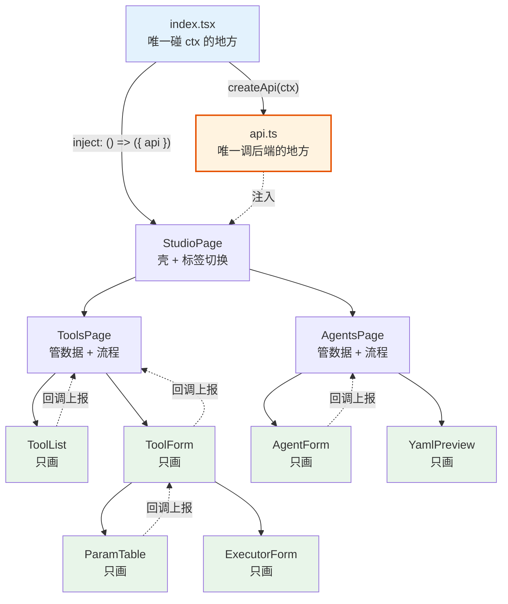

**看图要点**：

- **蓝色**（`index.tsx`）是唯一碰 `ctx` 的
- **橙色**（`api.ts`）是唯一调后端的
- **绿色**全是纯组件——**不认识后端，不认识 ctx**，给数据就画
- 数据往下传（实线），改动通过回调往上报（虚线）

> 🧠 **一句话记住这套设计**：页面负责"怎么想"，组件负责"怎么画"。
> 想让组件复用、想给组件写测试、想换一套界面——都因为这条线而变得容易。

---

# 附录 · 术语速查

| 术语 | 大白话 |
|---|---|
| **bundle** | 能装进 dsh 的插件包 |
| **profile** | 一种启动形态（网页版 / 命令行版 / SDK 版…） |
| **patch** | 按名字定位配置行，整行替换或插入新行 |
| **preset** | 一个助手的"人设 + 技能表" |
| **roster** | preset 的名册 |
| **slot** | 网页上的"预留插槽"，插件往里塞界面 |
| **Typert** | 前后端之间的类型化对话管道 |
| **fiber** | 插件的生命周期单位；`ctx` 上注册的一切随它自动回收 |
| **host plane / agent plane** | 整个程序共用的部分 / 每个对话单独的部分 |
| **Cordis** | dsh 的插件容器（管加载、依赖、卸载） |
| **ctx** | 插件的"万能遥控器"，一切能力都从它拿 |
| **inject** | "我需要哪些能力"的声明 |
